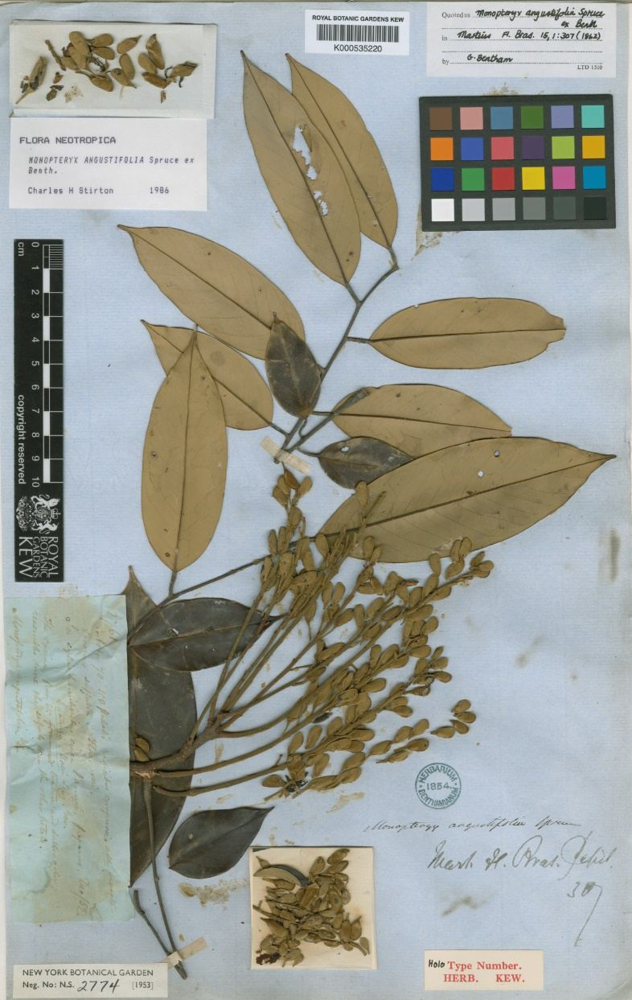
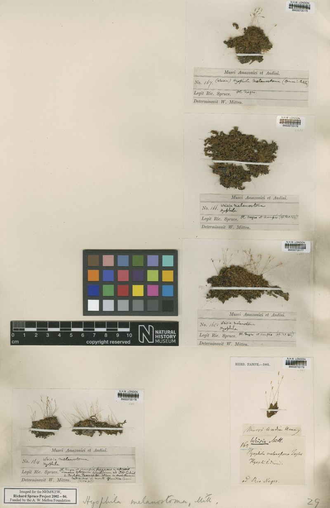
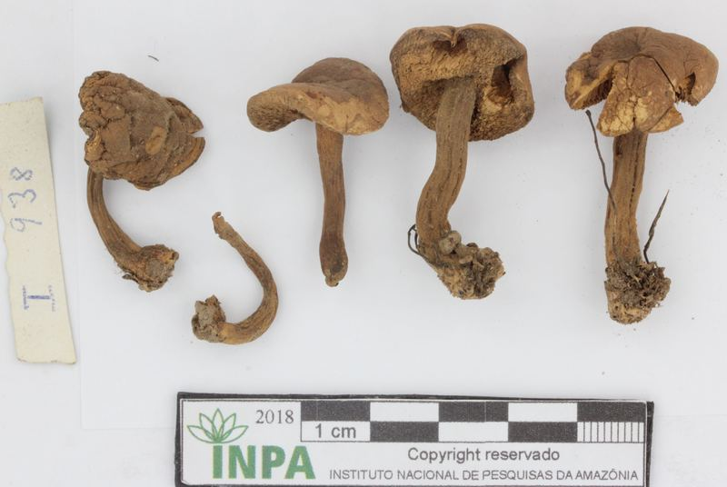
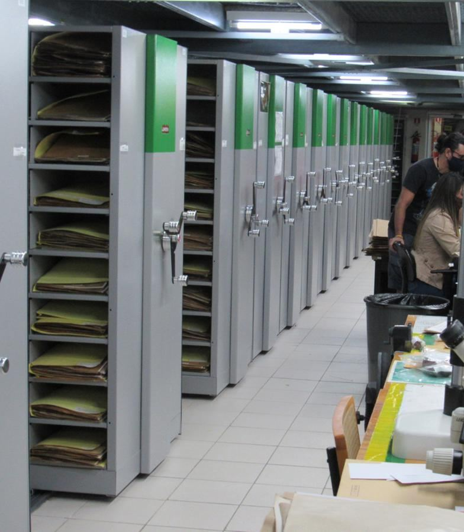

```{r conservacao-setup, include=FALSE}
knitr::opts_chunk$set(echo = FALSE, warning = FALSE, message = FALSE)

# Funções reaproveitáveis (leitura DwC, indicadores, gráficos SVG, exportação JSON).
modulo <- Find(file.exists, c("../R/painel_biodiversidade.R", "R/painel_biodiversidade.R"))
source(modulo, encoding = "UTF-8")
raiz_projeto <- dirname(dirname(normalizePath(modulo, winslash = "/")))

catalogo <- carregar_catalogo_dwc(list(
  list(
    rotulo = "Expedições Tsiino Hiiwiida",
    arquivos = c("_input_data/dwc_expedicoes_tsiino_validado.xlsx",
                 "_input_data/dwc_expedicoes_tsiino_tratado.xlsx",
                 "_input_data/dwc_expedicoes_tsiino.xlsx")
  ),
  list(
    rotulo = "Coleções existentes / GBIF",
    arquivos = c("_input_data/dwc_gbif_colecoes_validado.xlsx",
                 "_input_data/dwc_gbif_colecoes_tratado.xlsx",
                 "_input_data/dwc_gbif_colecoes.xlsx")
  )
), fonte_projeto = "Expedições Tsiino Hiiwiida")
catalog_all_dwc <- catalogo$todos
catalog_species_dwc <- catalogo$especies

# A lista de espécies vai para JSON (carregado sob demanda no navegador), não para o HTML.
exportar_catalogo_json(catalog_species_dwc, file.path(raiz_projeto, "assets", "data", "acesso"))
DATA_DIR <- "../assets/data/acesso"
```

```{=html}
<link rel="preconnect" href="https://fonts.googleapis.com">
<link rel="preconnect" href="https://fonts.gstatic.com" crossorigin>
<link href="https://fonts.googleapis.com/css2?family=Montserrat:wght@400;500;600;700;800;900&family=Source+Serif+4:opsz,wght@8..60,400;8..60,600;8..60,700&family=Space+Mono:wght@400;700&display=swap" rel="stylesheet">

<link rel="stylesheet" href="../assets/css/pages/acesso.css">
<link rel="stylesheet" href="../assets/css/tsiino-base.css">
<style>
/* Fica no documento de propósito: estas regras usam var(--img), cujo url()
   vem do atributo style do HTML. O Chrome resolve url() de variáveis CSS
   relativo à folha de estilo que usa a variável; mantendo a regra aqui, os
   caminhos "../figures/..." continuam relativos à página em qualquer navegador. */
.image-card{ background: var(--image-overlay, linear-gradient(180deg, rgba(46,59,36,0.06), rgba(16,18,12,0.78))), var(--img), var(--tone, var(--green-dark)); background-size: cover; background-position: center; }
.indicator-photo-card{ background: linear-gradient(180deg, rgba(46,59,36,0.08), rgba(15,18,11,0.86)), var(--img), linear-gradient(135deg, var(--tone), var(--green-dark)); background-size: cover; background-position: center; }
.data-photo-main{ background: linear-gradient(180deg, rgba(46,59,36,0.04), rgba(16,18,12,0.76)), var(--img), linear-gradient(135deg, rgba(46,59,36,0.92), rgba(98,106,56,0.74)); background-size: cover; background-position: center; }
</style>
```

```{=html}
<section class="conservation-hero" aria-label="Abertura da página de conservação">
  <div class="hero-inner">
    <div class="hero-kicker reveal" data-reveal>Conservação · Alto Rio Negro</div>
    <h1 class="reveal conservation-title" data-reveal>
      <span class="title-line title-nowrap">Plantas e fungos</span>
      <span class="title-line">do Alto Rio Negro.</span>
    </h1>
    <p class="hero-deck reveal" data-reveal>O Tsiino Hiiwiida reúne expedições, coleções históricas, identificação taxonômica, DNA e dados públicos para ampliar o conhecimento sobre a flora e a funga da Cabeça do Cachorro.</p>
  </div>
</section>
```

```{=html}
<section id="introducao" class="content-card intro-wide-card">
  <div class="section-title reveal" data-reveal>
    <h2>Campo, acervos e novos registros</h2>
  </div>
  <div class="intro-layout-wide">
    <div class="intro-copy">
      <p class="lead reveal" data-reveal>O Alto Rio Negro, no noroeste da Amazônia, combina campinaranas, florestas de terra firme, igapós, formações aluviais e serras em uma região reconhecida como uma das grandes lacunas de conhecimento da biodiversidade brasileira.</p>
      <p class="reveal" data-reveal>O projeto integra registros históricos acumulados em herbários, bases públicas e plataformas agregadoras com as coletas realizadas nas expedições atuais. Essa leitura conjunta evidencia o que já foi documentado, onde ainda existem vazios de amostragem e a contribuição das expedições do projeto para a documentação da Cabeça do Cachorro.</p>
      <p class="reveal" data-reveal>As coleções biológicas sustentam a rastreabilidade dos dados: cada voucher pode ser revisado, comparado, georreferenciado, associado a amostras de tecido e incorporado a análises taxonômicas, filogenéticas e ambientais. O resultado é uma base pública para inventários, revisões, biomonitoramento e estratégias de conservação.</p>
      <div class="big-statement reveal" data-reveal>Campo, herbários, bases públicas e amostras moleculares formam uma infraestrutura comum para documentar plantas, fungos, habitats e lacunas de conhecimento no Alto Rio Negro.</div>
      <div class="mini-facts">
        <div class="mini-fact reveal" data-reveal><strong>170+</strong><span>anos de expedições e coleções históricas</span></div>
        <div class="mini-fact reveal" data-reveal><strong>2</strong><span>fontes de dados integradas ao painel</span></div>
        <div class="mini-fact reveal" data-reveal><strong>4</strong><span>leituras: geral, fungos, fanerógamas e criptógamas</span></div>
      </div>
    </div>
    <div class="specimen-panel reveal" data-reveal aria-label="Exsicatas e acervos de referência">
      <article class="specimen-card fanero"><figure><figcaption><b>Exsicata · fanerógama</b><span>Voucher, etiqueta e material fértil preservados.</span></figcaption></figure></article>
      <article class="specimen-card cripto"><figure><figcaption><b>Exsicata · criptógama</b><span>Briófitas, samambaias ou licófitas revisadas.</span></figcaption></figure></article>
      <article class="specimen-card fungo"><figure><figcaption><b>Voucher · fungo</b><span>Registro associado a coleta, substrato e identificação.</span></figcaption></figure></article>
      <article class="herbarium-mini-card"><figure><figcaption><b>Acervos</b><span> </span></figcaption></figure></article>
    </div>
  </div>
</section>
```

```{=html}
<section class="full-bleed-gallery" aria-label="História visual das coletas no Alto Rio Negro">
  <div class="gallery-title-wrap reveal" data-reveal>
    <h2 class="gallery-title">Viajantes, coleções e novas expedições</h2>
  </div>
  <div class="image-strip">
    <article class="image-card reveal" data-reveal style="--img: url('../figures/conservacao/web/wallace.jpg'); --tone: #2E3B24;"><div class="chip">Wallace</div><div class="copy"><h3>Primeiras leituras do Rio Negro</h3><p>Retratos, mapas e registros históricos ajudam a situar a longa história de exploração científica da região.</p></div></article>
    <article class="image-card reveal" data-reveal style="--img: url('../figures/conservacao/web/spruce.jpg'); --tone: #626A38;"><div class="chip">Spruce</div><div class="copy"><h3>Coletas que atravessam séculos</h3><p>Exsicatas, cadernos de campo e coleções históricas conectam expedições antigas às perguntas atuais.</p></div></article>
    <article class="image-card reveal" data-reveal style="--img: url('../figures/conservacao/web/ducke.jpg'); --tone: #6E1F1D;"><div class="chip">Ducke</div><div class="copy"><h3>Botânica amazônica em revisão</h3><p>O estudo de coleções permite revisitar identificações, lacunas de coleta e vieses históricos de amostragem.</p></div></article>
    <article class="image-card reveal" data-reveal style="--img: url('../figures/conservacao/web/expedicao_recente.jpg'); --tone: #626A38;"><div class="chip">Expedições científicas recentes</div><div class="copy"><h3>Novas coletas na Cabeça do Cachorro</h3><p>Trilhas, rios, campinas, florestas e serras ampliam a documentação atual do Alto Rio Negro.</p></div></article>
    <article class="image-card clean-photo reveal" data-reveal style="--img: url('../figures/conservacao/web/herbario.jpg'); --tone: #2E3B24;"><div class="chip">Coleções biológicas</div><div class="copy"><h3>Coleções como infraestrutura</h3><p>Armários, etiquetas, vouchers e amostras conectam campo, taxonomia, DNA e bancos públicos.</p></div></article>
  </div>
</section>
```

```{=html}
<section id="resultados-indicadores" class="content-card results-section">
  <div class="section-title reveal" data-reveal>
    <h2>Indicadores gerais</h2>
  </div>
  <p class="lead reveal" data-reveal>Os painéis abaixo são atualizados a partir de um catálogo validado previamente em R, reunindo as coletas das expedições atuais e os registros já existentes para a região, obtidos de coleções e bases agregadoras.</p>
  <p class="reveal" data-reveal>O painel geral e os painéis por grupo mostram o total e a proporção de registros das expedições Tsiino Hiiwiida em relação ao conjunto de dados. O painel geral também mostra o nível de identificação dos registros — até espécie, até gênero, até família ou indeterminados — para acompanhar a qualidade taxonômica da base.</p>
  <div class="indicator-photo-row reveal" data-reveal aria-label="Grupos biológicos monitorados nos indicadores">
    <article class="indicator-photo-card" style="--img: url('../figures/conservacao/web/fanerogama_campo.jpg'); --tone: #626A38;"><span>Fanerógamas</span><h3>Plantas com sementes</h3><p>Árvores, lianas, arbustos, ervas e táxons de interesse para revisão taxonômica, história evolutiva e usos potenciais.</p></article>
    <article class="indicator-photo-card" style="--img: url('../figures/conservacao/web/criptogama_campo.jpg'); --tone: #2E3B24;"><span>Criptógamas</span><h3>Briófitas, samambaias e licófitas</h3><p>Grupos sensíveis a microhabitats, importantes para leitura ambiental, biomonitoramento e diversidade críptica.</p></article>
    <article class="indicator-photo-card" style="--img: url('../figures/conservacao/web/fungo_campo.jpg'); --tone: #6E1F1D;"><span>Fungos</span><h3>Funga em campo</h3><p>Macrofungos, fungos liquenizados e linhagens associadas a substratos, hospedeiros e processos ecológicos.</p></article>
  </div>
```

```{r conservacao-input-status}
input_status_panel(catalogo$inputs)
```

```{r conservacao-painel-geral}
render_dashboard(
  title = "Painel geral · flora e funga",
  subtitle = "Síntese integrada da flora e funga documentada pelas coleções existentes e pelas expedições atuais. O painel reúne fanerógamas, criptógamas e fungos, evidenciando riqueza, gêneros, famílias, registros, georreferenciamento e a contribuição das expedições do projeto.",
  group_filter = NULL
)
```

```{=html}
</section>
```

```{=html}
<section id="paineis-especificos" class="content-card results-section">
  <div class="section-title reveal" data-reveal>
    <h2>Painéis por grupo</h2>
  </div>
```

```{r conservacao-painel-fungos}
render_dashboard(
  title = "Fungos",
  subtitle = "Leitura específica para macrofungos, fungos liquenizados, fungos parasitas e demais registros classificados no reino Fungi. O painel ajuda a acompanhar um dos grupos menos documentados da Amazônia.",
  group_filter = "Fungos",
  compact = TRUE,
  data_dir = DATA_DIR
)
```

```{r conservacao-painel-fanerogamas}
render_dashboard(
  title = "Fanerógamas",
  subtitle = "Síntese das plantas com sementes registradas na região, incluindo árvores, lianas, arbustos, ervas e espécies de interesse para revisões taxonômicas, história evolutiva, bioeconomia e segurança alimentar.",
  group_filter = "Fanerógamas",
  compact = TRUE,
  data_dir = DATA_DIR
)
```

```{r conservacao-painel-criptogamas}
render_dashboard(
  title = "Criptógamas",
  subtitle = "Painel dedicado a briófitas, samambaias, licófitas e outros grupos historicamente subamostrados, importantes para compreender microhabitats, biomonitoramento e diversidade críptica.",
  group_filter = "Criptógamas",
  compact = TRUE,
  data_dir = DATA_DIR
)
```

```{=html}
</section>
```

```{=html}
<section id="infraestrutura-dados" class="content-card data-infra-section">
  <div class="section-title reveal" data-reveal>
    <h2>Infraestrutura dos dados</h2>
  </div>
  <div class="data-infra-layout">
    <div class="data-infra-copy">
      <p class="lead reveal" data-reveal>Conectar expedições atuais, coleções históricas, herbários amazônicos e bases agregadoras transforma registros dispersos em uma base rastreável para pesquisa, gestão e comunicação pública.</p>
      <p class="reveal" data-reveal>A curadoria dos dados passa por limpeza de nomes, padronização Darwin Core, validação taxonômica, revisão de coordenadas, organização de vouchers e integração com bancos públicos. Esse trabalho reduz ruídos, torna os registros comparáveis e permite que cada indicador volte a uma evidência verificável.</p>
      <p class="reveal" data-reveal>O painel segue uma lógica FAIR: dados encontráveis, acessíveis, interoperáveis e reutilizáveis. À medida que novas coletas entram no acervo, as informações podem circular entre herbários, GBIF, speciesLink, Jabot, Reflora, bancos moleculares e materiais de divulgação do Tsiino Hiiwiida.</p>
      <div class="data-principles reveal" data-reveal>
        <article><b>Limpeza</b><span>nomes, duplicatas, campos vazios e grafias inconsistentes</span></article>
        <article><b>Validação</b><span>identificações, famílias, gêneros, vouchers e coordenadas</span></article>
        <article><b>Integração</b><span>expedições, herbários, GBIF, speciesLink, Jabot e Reflora</span></article>
        <article><b>Acesso</b><span>sínteses públicas, dados interoperáveis e documentação contínua</span></article>
      </div>
    </div>
    <div class="data-infra-visual reveal" data-reveal>
      <div class="data-photo-main" style="--img: url('../figures/conservacao/web/herbarium_blitz.jpg');"><div class="caption"><b>Curadoria e validação</b><span>Revisão taxonômica, digitalização, checagem de vouchers e organização dos registros para circulação pública.</span></div></div>
      <div class="data-flow-card"><span>Fluxo dos dados</span><ol><li>Coleta e voucher</li><li>Identificação revisável</li><li>Padronização Darwin Core</li><li>Integração com bases públicas</li></ol></div>
    </div>
  </div>
</section>
```

```{=html}
<section id="conservacao-catalogo" class="content-card">
  <div class="section-title reveal" data-reveal>
    <h2>Do registro à conservação</h2>
  </div>
  <p class="lead reveal" data-reveal>Os indicadores desta página são uma camada pública de leitura dos dados. Cada número se conecta a uma coleta, um voucher, uma identificação revisável e, quando disponível, uma amostra associada para estudos moleculares.</p>
  <p class="reveal" data-reveal>Ao reunir coleções históricas, expedições atuais, validação taxonômica, digitalização de acervos e amostras de DNA, o Tsiino Hiiwiida transforma dados dispersos em uma base de conhecimento capaz de apoiar inventários, pesquisas evolutivas, políticas de conservação, bioeconomia e comunicação pública sobre a biodiversidade do Alto Rio Negro.</p>
</section>
```

```{=html}
<script>
(function(){
  document.documentElement.classList.add('js');
  var prefersReducedMotion = window.matchMedia && window.matchMedia('(prefers-reduced-motion: reduce)').matches;
  var numberFormatter = new Intl.NumberFormat('pt-BR');

  function animateCounter(el){
    if(!el || el.dataset.counted === 'true') return;
    var finalText = el.dataset.finalText || el.textContent.trim();
    var target = Number(el.dataset.countFinal);
    if(prefersReducedMotion || !Number.isFinite(target)){
      el.textContent = finalText;
      el.dataset.counted = 'true';
      return;
    }
    el.dataset.counted = 'true';
    var duration = 1180;
    var start = performance.now();
    var digits = Math.max(String(Math.round(target)).length, 2);
    var maxRandom = Math.max(target, Math.pow(10, Math.min(digits + 1, 6)) - 1);
    function frame(now){
      var progress = Math.min(1, (now - start) / duration);
      var eased = 1 - Math.pow(1 - progress, 3);
      if(progress < 0.68){
        var jitterBase = Math.round(target * eased);
        var randomPart = Math.floor(Math.random() * Math.max(1, maxRandom * (1 - progress * 0.55)));
        el.textContent = numberFormatter.format(Math.max(0, Math.round((jitterBase + randomPart) / 2)));
      } else {
        el.textContent = numberFormatter.format(Math.round(target * eased));
      }
      if(progress < 1){ requestAnimationFrame(frame); } else { el.textContent = finalText; }
    }
    requestAnimationFrame(frame);
  }

  function animateInside(el){
    if(!el) return;
    if(el.matches && el.matches('.kpi-card')) animateCounter(el.querySelector('.kpi-number'));
    el.querySelectorAll && el.querySelectorAll('.kpi-number').forEach(animateCounter);
    if(el.classList && el.classList.contains('chart-card')){
      el.classList.add('chart-visible');
    }
  }

  function revealNow(){
    document.querySelectorAll('.reveal').forEach(function(el){
      var rect = el.getBoundingClientRect();
      if(rect.top < window.innerHeight * 0.92){ el.classList.add('is-visible'); animateInside(el); }
    });
  }

  function setupReveal(){
    var els = document.querySelectorAll('.reveal');
    if(prefersReducedMotion || !('IntersectionObserver' in window)){
      els.forEach(function(el){ el.classList.add('is-visible'); animateInside(el); });
      return;
    }
    var observer = new IntersectionObserver(function(entries){
      entries.forEach(function(entry){
        if(entry.isIntersecting){ entry.target.classList.add('is-visible'); animateInside(entry.target); observer.unobserve(entry.target); }
      });
    }, { threshold: 0.12, rootMargin: '0px 0px -6% 0px' });
    els.forEach(function(el, i){ el.style.transitionDelay = Math.min(i % 6, 5) * 70 + 'ms'; observer.observe(el); });
    revealNow(); setTimeout(revealNow, 260); setTimeout(revealNow, 800);
  }

  function setupPage(){ setupReveal(); }
  if(document.readyState === 'loading') document.addEventListener('DOMContentLoaded', setupPage); else setupPage();
})();
</script>
<link rel="stylesheet" href="../assets/css/painel-biodiversidade.css">
<script src="../assets/js/catalogo-especies.js" defer></script>
```

