```{r setup, include=FALSE}
knitr::opts_chunk$set(echo = FALSE, warning = FALSE, message = FALSE)

find_up <- function(rel_path, start = getwd(), max_levels = 8) {
  d <- normalizePath(start, winslash = "/", mustWork = FALSE)
  for (i in 0:max_levels) {
    cand <- file.path(d, rel_path)
    if (file.exists(cand)) return(cand)
    parent <- dirname(d)
    if (identical(parent, d)) break
    d <- parent
  }
  NA_character_
}

read_optional_csv <- function(rel_path) {
  path <- find_up(rel_path)
  if (is.na(path)) return(data.frame())
  tryCatch(
    read.csv(
      path,
      stringsAsFactors = FALSE,
      check.names = FALSE,
      fileEncoding = "UTF-8-BOM",
      na.strings = c("", "NA", "NaN")
    ),
    error = function(e) data.frame()
  )
}

col_or <- function(data, candidates, default = "") {
  if (nrow(data) == 0) return(character())
  hit <- intersect(candidates, names(data))
  if (length(hit) == 0) return(rep(default, nrow(data)))
  x <- as.character(data[[hit[1]]])
  x[is.na(x)] <- default
  x
}

nz <- function(x) !is.na(x) & nzchar(trimws(as.character(x)))

safe <- function(x) {
  x <- as.character(x)
  x[is.na(x) | trimws(x) == ""] <- "—"
  htmltools::htmlEscape(x)
}
```

```{=html}
<link rel="preconnect" href="https://fonts.googleapis.com">
<link rel="preconnect" href="https://fonts.gstatic.com" crossorigin>
<link href="https://fonts.googleapis.com/css2?family=Montserrat:wght@400;500;600;700;800;900&family=Source+Serif+4:opsz,wght@8..60,400;8..60,600;8..60,700&family=Space+Mono:wght@400;700&display=swap" rel="stylesheet">

<link
  rel="stylesheet"
  href="https://unpkg.com/leaflet@1.9.4/dist/leaflet.css"
/>

<script
  src="https://unpkg.com/leaflet@1.9.4/dist/leaflet.js">
</script>
<link rel="stylesheet" href="assets/css/pages/sobre.css">
<link rel="stylesheet" href="assets/css/tsiino-base.css">

<script>
document.addEventListener("DOMContentLoaded", function () {
  /* Destaque automático da navbar */
  const sections = document.querySelectorAll("section[id]");
  const navLinks = document.querySelectorAll(".navbar a[href*='#']");

  const observer = new IntersectionObserver(
    entries => {
      entries.forEach(entry => {
        if (entry.isIntersecting) {
          const id = entry.target.id;

          navLinks.forEach(link => {
            link.classList.remove("active-section");
            const href = link.getAttribute("href");
            if (href && href.endsWith("#" + id)) {
              link.classList.add("active-section");
            }
          });
        }
      });
    },
    {
      root: null,
      rootMargin: "-35% 0px -55% 0px",
      threshold: 0
    }
  );

  sections.forEach(section => {
    if (section.id) observer.observe(section);
  });

  /* Vídeo da hero: autoplay robusto + botão play/pause sem caracteres quebrados */
  const video = document.querySelector(".hero-video");
  const toggle = document.querySelector(".hero-video-toggle");

  if (video) {
    video.muted = true;
    video.defaultMuted = true;
    video.playsInline = true;
    video.setAttribute("muted", "");
    video.setAttribute("playsinline", "");
    video.setAttribute("autoplay", "");

    const updateHeroVideoButton = function () {
      if (!toggle) return;
      const isPaused = video.paused || video.ended;
      toggle.classList.toggle("is-paused", isPaused);
      toggle.setAttribute("aria-label", isPaused ? "Reproduzir vídeo" : "Pausar vídeo");
      toggle.setAttribute("aria-pressed", isPaused ? "true" : "false");
    };

    const startHeroVideo = function () {
      if (video.dataset.userPaused === "1") {
        updateHeroVideoButton();
        return;
      }

      const playPromise = video.play();
      if (playPromise && typeof playPromise.then === "function") {
        playPromise.then(updateHeroVideoButton).catch(updateHeroVideoButton);
      } else {
        updateHeroVideoButton();
      }
    };

    startHeroVideo();
    window.addEventListener("load", startHeroVideo, { once: true });
    window.addEventListener("pageshow", startHeroVideo);

    document.addEventListener("visibilitychange", function () {
      if (!document.hidden) startHeroVideo();
    });

    video.addEventListener("play", updateHeroVideoButton);
    video.addEventListener("pause", updateHeroVideoButton);

    if (toggle) {
      updateHeroVideoButton();
      toggle.addEventListener("click", function () {
        if (video.paused) {
          delete video.dataset.userPaused;
          startHeroVideo();
        } else {
          video.dataset.userPaused = "1";
          video.pause();
          updateHeroVideoButton();
        }
      });
    }
  }

  /* Carrossel principal dos objetivos */
  const objectiveSlides = document.querySelectorAll(".objective-slide");
  const objectiveDots = document.querySelectorAll(".objective-dot");
  const objectivePrev = document.querySelector(".objective-prev");
  const objectiveNext = document.querySelector(".objective-next");
  const objectivesSection = document.getElementById("objetivos");

  let objectiveIndex = 0;
  let objectiveTimer = null;
  let objectiveAutoplayStarted = false;

  function showObjectiveSlide(index) {
    if (!objectiveSlides.length) return;

    objectiveIndex = (index + objectiveSlides.length) % objectiveSlides.length;

    objectiveSlides.forEach((slide, i) => {
      slide.classList.toggle("active", i === objectiveIndex);
    });

    objectiveDots.forEach((dot, i) => {
      dot.classList.toggle("active", i === objectiveIndex);
    });

    resetObjectivePhotoCarousel(objectiveSlides[objectiveIndex]);
  }

  function restartObjectiveTimer() {
    if (objectiveTimer) clearInterval(objectiveTimer);

    objectiveTimer = setInterval(function () {
      showObjectiveSlide(objectiveIndex + 1);
    }, 9000);
  }

  if (objectiveSlides.length) {
    const startObjectiveAutoplay = function () {
      if (objectiveAutoplayStarted) return;
      objectiveAutoplayStarted = true;
      restartObjectiveTimer();
    };

    showObjectiveSlide(0);

    if (objectivePrev) {
      objectivePrev.addEventListener("click", function () {
        showObjectiveSlide(objectiveIndex - 1);
        startObjectiveAutoplay();
        restartObjectiveTimer();
      });
    }

    if (objectiveNext) {
      objectiveNext.addEventListener("click", function () {
        showObjectiveSlide(objectiveIndex + 1);
        startObjectiveAutoplay();
        restartObjectiveTimer();
      });
    }

    objectiveDots.forEach((dot, i) => {
      dot.addEventListener("click", function () {
        showObjectiveSlide(i);
        startObjectiveAutoplay();
        restartObjectiveTimer();
      });
    });

    if (objectivesSection && "IntersectionObserver" in window) {
      const objectiveObserver = new IntersectionObserver(entries => {
        entries.forEach(entry => {
          if (entry.isIntersecting) {
            showObjectiveSlide(0);
            startObjectiveAutoplay();
            objectiveObserver.disconnect();
          }
        });
      }, {
        threshold: 0.35,
        rootMargin: "0px 0px -10% 0px"
      });

      objectiveObserver.observe(objectivesSection);
    } else {
      startObjectiveAutoplay();
    }
  }

  /* Carrossel interno de fotos de cada objetivo */
  function resetObjectivePhotoCarousel(slide) {
    if (!slide) return;

    const photos = slide.querySelectorAll(".objective-photo-slide");
    const photoDots = slide.querySelectorAll(".objective-photo-dot");

    photos.forEach((photo, i) => {
      photo.classList.toggle("active", i === 0);
    });

    photoDots.forEach((dot, i) => {
      dot.classList.toggle("active", i === 0);
    });

    slide.dataset.photoIndex = "0";
  }

  function showObjectivePhoto(slide, index) {
    const photos = slide.querySelectorAll(".objective-photo-slide");
    const photoDots = slide.querySelectorAll(".objective-photo-dot");

    if (!photos.length) return;

    const nextIndex = (index + photos.length) % photos.length;
    slide.dataset.photoIndex = String(nextIndex);

    photos.forEach((photo, i) => {
      photo.classList.toggle("active", i === nextIndex);
    });

    photoDots.forEach((dot, i) => {
      dot.classList.toggle("active", i === nextIndex);
    });
  }

  document.querySelectorAll(".objective-slide").forEach(slide => {
    const photoPrev = slide.querySelector(".objective-photo-prev");
    const photoNext = slide.querySelector(".objective-photo-next");
    const photoDots = slide.querySelectorAll(".objective-photo-dot");

    slide.dataset.photoIndex = "0";

    if (photoPrev) {
      photoPrev.addEventListener("click", function (event) {
        event.stopPropagation();
        const current = Number(slide.dataset.photoIndex || 0);
        showObjectivePhoto(slide, current - 1);
      });
    }

    if (photoNext) {
      photoNext.addEventListener("click", function (event) {
        event.stopPropagation();
        const current = Number(slide.dataset.photoIndex || 0);
        showObjectivePhoto(slide, current + 1);
      });
    }

    photoDots.forEach((dot, i) => {
      dot.addEventListener("click", function (event) {
        event.stopPropagation();
        showObjectivePhoto(slide, i);
      });
    });
  });

  setInterval(function () {
    const activeSlide = document.querySelector(".objective-slide.active");
    if (!activeSlide) return;

    const current = Number(activeSlide.dataset.photoIndex || 0);
    showObjectivePhoto(activeSlide, current + 1);
  }, 3500);
  /* Mapa do município de São Gabriel da Cachoeira na seção O projeto */
  const projectMapEl = document.getElementById("project-sgc-map");

  if (projectMapEl && typeof L !== "undefined") {
    const projectMap = L.map("project-sgc-map", {
      zoomControl: false,
      scrollWheelZoom: false,
      dragging: true,
      attributionControl: false
    });

L.tileLayer(
  "https://server.arcgisonline.com/ArcGIS/rest/services/World_Imagery/MapServer/tile/{z}/{y}/{x}",
  {
    maxZoom: 18
  }
).addTo(projectMap);

    fetch("_input_data/limites/sao_gabriel_da_cachoeira.geojson")
      .then(response => {
        if (!response.ok) {
          throw new Error("GeoJSON não encontrado");
        }
        return response.json();
      })
      .then(geojson => {
        const sgcLayer = L.geoJSON(geojson, {
          style: {
            color: "#A93632",
            weight: 3,
            opacity: 1,
            fillColor: "#626A38",
            fillOpacity: 0.18
          }
        }).addTo(projectMap);

        projectMap.fitBounds(sgcLayer.getBounds(), {
          padding: [18, 18]
        });

        L.control.zoom({
          position: "bottomright"
        }).addTo(projectMap);
      })
      .catch(error => {
        projectMapEl.innerHTML =
          '<div style="padding:1rem;font-family:Montserrat,Arial,sans-serif;font-size:0.85rem;color:#2E3B24;">Não foi possível carregar o limite municipal. Confira se o arquivo <strong>_input_data/limites/sao_gabriel_da_cachoeira.geojson</strong> existe.</div>';
      });
  }
});

document.addEventListener("DOMContentLoaded", function () {
  const revealTargets = document.querySelectorAll(
    ".content-card, .objectives-section, .full-bleed-feature"
  );

  revealTargets.forEach((el, index) => {
    el.classList.add("reveal-ready");
    el.style.setProperty("--reveal-delay", `${Math.min(index, 6) * 55}ms`);
  });

  if (window.matchMedia("(prefers-reduced-motion: reduce)").matches) {
    revealTargets.forEach(el => el.classList.add("is-visible"));
    return;
  }

  const revealObserver = new IntersectionObserver(
    entries => {
      entries.forEach(entry => {
        if (entry.isIntersecting) {
          entry.target.classList.add("is-visible");
          revealObserver.unobserve(entry.target);
        }
      });
    },
    {
      threshold: 0.12,
      rootMargin: "0px 0px -8% 0px"
    }
  );

  revealTargets.forEach(el => revealObserver.observe(el));
});

</script>
```

```{=html}
<section class="hero-strip" aria-label="Abertura do projeto Tsiino Hiiwiida">
  <video
    class="hero-video"
    autoplay
    muted
    loop
    playsinline
    preload="auto"
    aria-hidden="true"
  >
    <source src="figures/video/tsiino_hero.mp4" type="video/mp4">
  </video>

  <div class="hero-overlay"></div>

  <div class="hero-logo-badge" aria-label="Logo Tsiino Hiiwiida">
    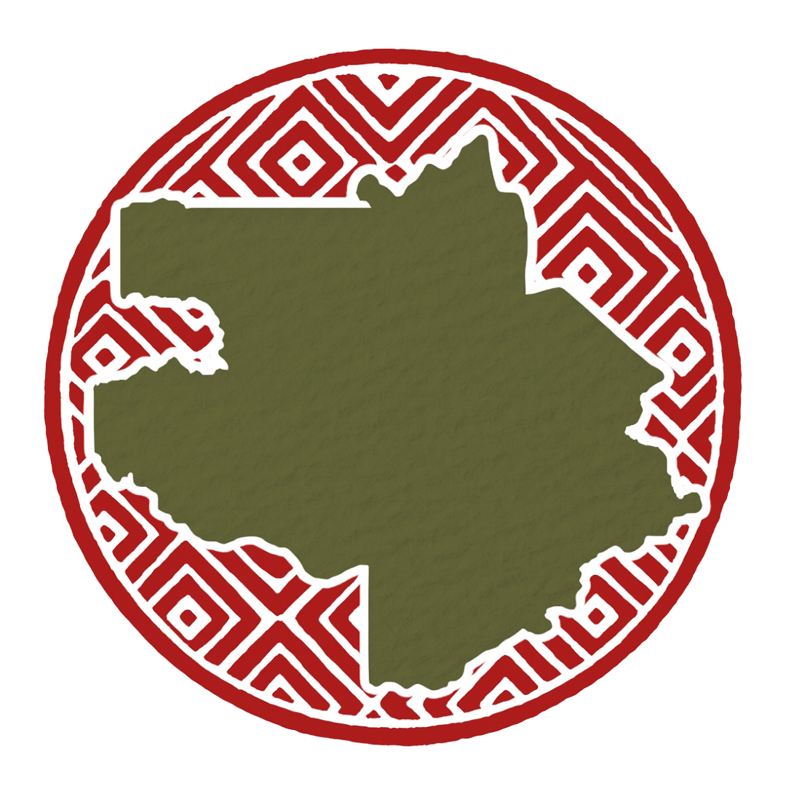
  </div>

  <div class="hero-title-panel">
    <div class="hero-kicker">Chamada Expedições · Iniciativa Amazônia+10 · Brasil + Reino Unido</div>
    <h1>Tsiino Hiiwiida</h1>
    <p class="hero-subtitle">Dimensões da biodiversidade de plantas e fungos no Alto Rio Negro</p>
    <p class="hero-description"></p>
  </div>

  <button class="hero-video-toggle" type="button" aria-label="Pausar vídeo" aria-pressed="false">
    <span class="icon-pause" aria-hidden="true"></span>
    <span class="icon-play" aria-hidden="true"></span>
  </button>
</section>
```

```{=html}

<section id="o-projeto" class="content-card about-section projeto-editorial">
  <div class="section-title">
    <h2>O projeto</h2>
  </div>
  <div class="about-intro-grid about-hero-grid">
    <div class="about-copy about-copy-editorial">
      <div class="about-eyebrow">Síntese</div>

      <h3 class="about-display-title">
        <span>Revelar múltiplas dimensões da</span>
        <span>biodiversidade</span>
        <span>no Alto Rio Negro.</span>
      </h3>

      <p class="lead">
        <strong>Tsiino Hiiwiida</strong>, nome Baniwa da região conhecida como Cabeça do Cachorro, é uma das últimas grandes fronteiras de conhecimento sobre a biodiversidade amazônica. O projeto foi aprovado na <strong>Chamada Expedições da Iniciativa Amazônia+10</strong> e está em execução, articulando instituições do Brasil e do Reino Unido para revelar múltiplas dimensões da flora e da funga no Alto Rio Negro.
      </p>

      <div class="about-copy-columns">
        <p>
          Campinaranas, florestas de terra-firme, igapós, serras e formações aluviais na fronteira entre Brasil, Colômbia e Venezuela. A heterogeneidade ambiental e a longa história geológica da Bacia Amazônica fazem da região um grande cenário para entender evolução, distribuição e endemismos.
        </p>

        <p>
          O objetivo é acelerar a documentação de plantas e fungos, preencher lacunas taxonômicas, biogeográficas e evolutivas, e formar novas redes de pesquisa com participação local. As expedições de campo se conectam à identificação taxonômica, coleções científicas, sistemática molecular, metagenômica, biomonitoramento e comunicação pública.
        </p>
      </div>

      <div class="about-pullquote">
        Da coleta em rios e serras ao catálogo público: o projeto transforma registros de campo, coleções biológicas em conhecimento acessível sobre a flora e a funga da Cabeça do Cachorro.
      </div>
    </div>
    <aside class="about-visual-module" aria-label="Resumo territorial e institucional">
      <figure class="about-photo-quote about-photo-expanded pe-main-photo">
        <div class="pe-image" data-label="Vista aérea do Alto Rio Negro com a formação da Bela Adormecida ao fundo">
          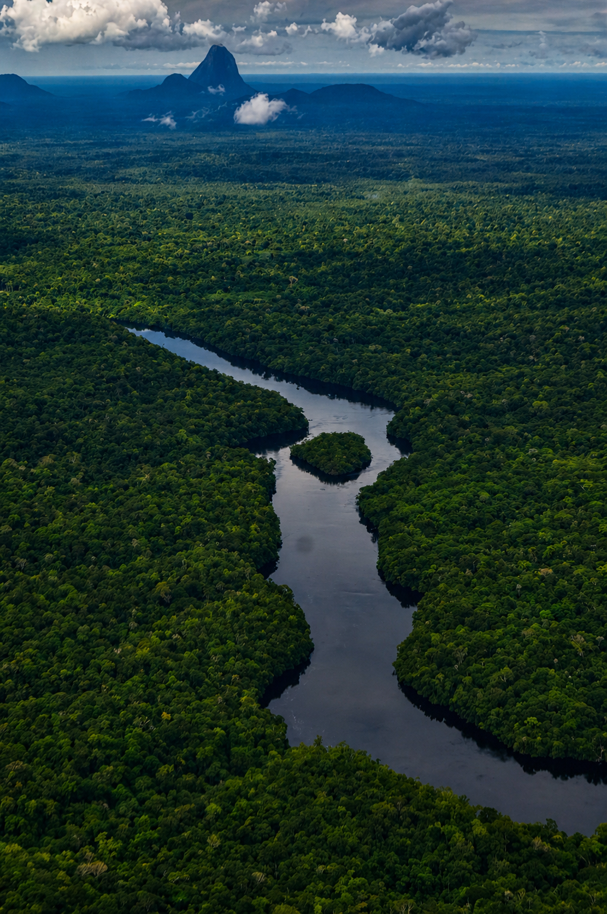
        </div>
        <figcaption>Alto Rio Negro · território, ciência e colaboração</figcaption>
      </figure>
        <div class="about-stat-grid about-stat-overlay" aria-label="Números-chave do projeto">
          <div class="about-stat">
            <strong>36</strong>
            <span>meses de duração</span>
          </div>

          <div class="about-stat">
            <strong>8</strong>
            <span>campanhas de campo</span>
          </div>

<div class="about-stat">
  <strong>30</strong>
  <span>instituições<br>Brasil + Reino Unido</span>
</div>
        </div>
      <div class="project-map-card about-map-compact">
        <div class="project-map-header">
          <h3>São Gabriel da Cachoeira</h3>
          <p>Município de atuação do projeto na região da Cabeça do Cachorro, Alto Rio Negro.</p>
        </div>

        <div id="project-sgc-map" aria-label="Mapa do município de São Gabriel da Cachoeira"></div>
      </div>
    </aside>
    <!-- Fontes preferenciais informadas no pedido. Ajuste apenas os caminhos
         se DSC_7419/DC0_7440/DC0_7451 estiverem em outra pasta local.
         As alternativas abaixo existem no repositório e não geram loops. -->
    <div class="pe-collage" aria-label="Registros fotográficos de campo">
      <figure class="pe-field-photo pe-landscape">
        <div class="pe-image" data-label="Paisagem do Alto Rio Negro">
          
        <figcaption>Paisagem · Alto Rio Negro</figcaption>
      </figure>
      <figure class="pe-field-photo pe-botanical">
        <div class="pe-image" data-label="Detalhe de planta em campo">
          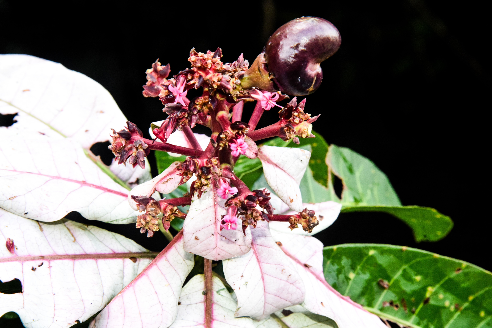
        <figcaption>Flora · registro de campo</figcaption>
      </figure>
      <figure class="pe-field-photo pe-documentary">
        <div class="pe-image" data-label="Equipe processando material botânico em campo">
          
        <figcaption>Coleções · trabalho de campo</figcaption>
      </figure>
    </div>
  </div>
</section>
```

```{=html}
<section id="frentes-integradas" class="full-bleed-feature" aria-label="Três eixos do projeto de pesquisa">
  <div class="feature-title-wrap">
    <div class="feature-eyebrow"></div>
    <div class="feature-title">Três eixos do Projeto</div>
  </div>

  <div class="feature-band">
    <article class="feature-photo" data-label="Equipe em atividade de levantamento de flora e funga em campo">
      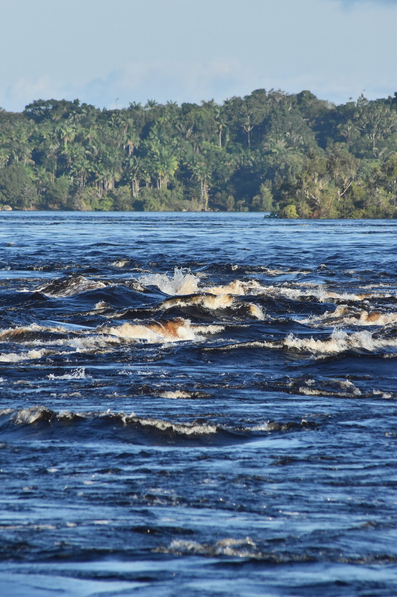
    </article>

    <article class="feature-panel feature-panel-green">
      <h3>Eixo 1</h3>
      <p class="axis-title">Habitats e espécies</p>
      <p class="axis-detail">Compreender campinaranas, florestas de terra-firme, igapós, serras e formações aluviais como mosaicos vivos da flora e da funga do Alto Rio Negro.</p>
    </article>

    <article class="feature-photo" data-label="Registro científico e taxonômico de plantas e fungos">
      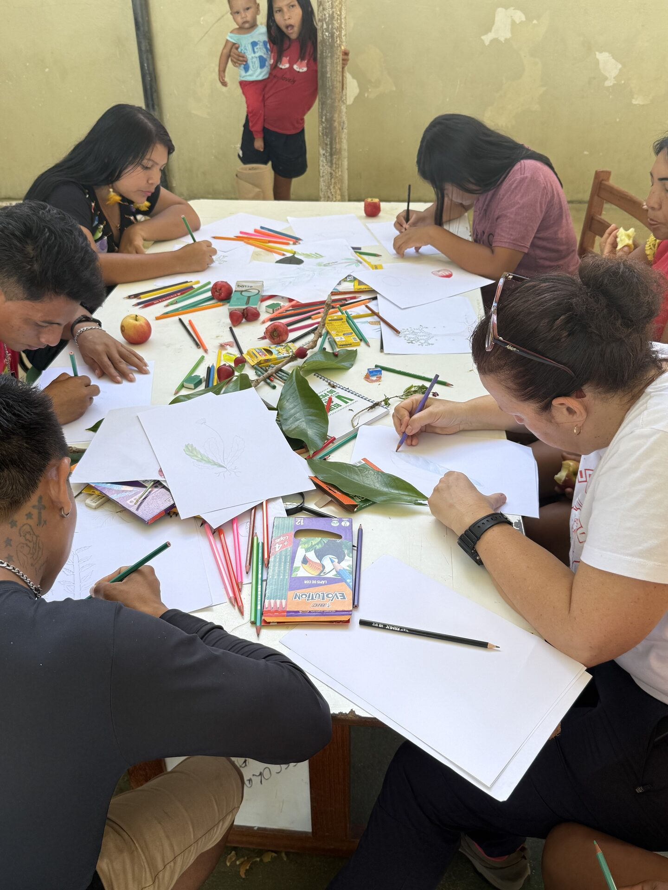
    </article>

    <article class="feature-panel feature-panel-deep">
      <h3>Eixo 2</h3>
      <p class="axis-title">Biodiversidade, sustento e bioeconomia</p>
      <p class="axis-detail">Investigar PANC, segurança alimentar, nutrientes, metais pesados e usos potenciais de espécies vegetais em diálogo com conhecimentos e demandas locais.</p>
    </article>

    <article class="feature-photo" data-label="Atividade de campo com colaboração local">
      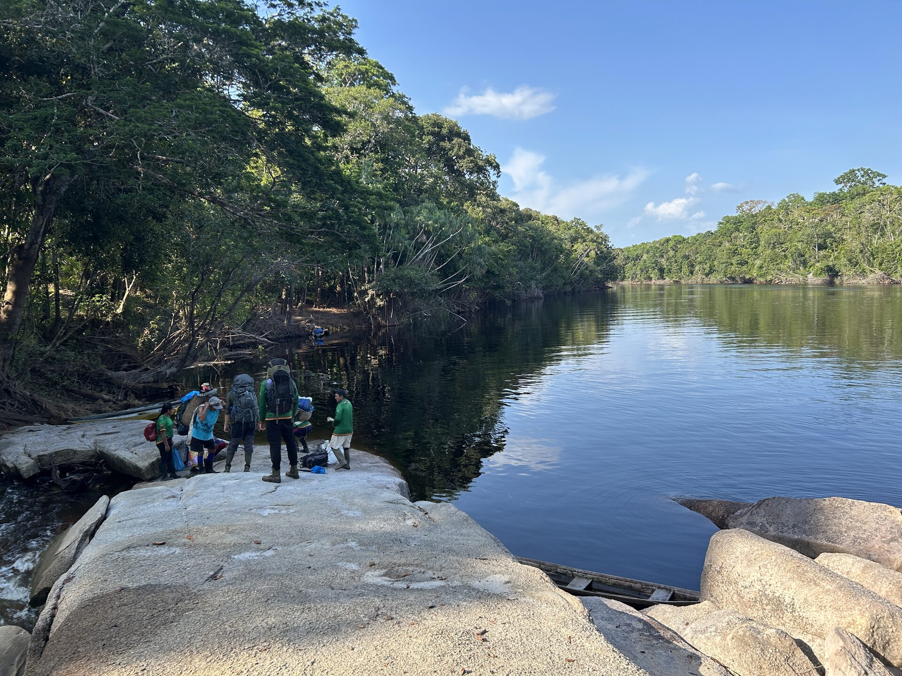
    </article>

    <article class="feature-panel feature-panel-ochre">
      <h3>Eixo 3</h3>
      <p class="axis-title">Campo e tecnologias emergentes</p>
      <p class="axis-detail">Integrar vouchers, coleções, DNA, metabarcoding, biomonitoramento, bancos de dados e comunicação pública para transformar coletas em conhecimento acessível.</p>
    </article>
  </div>
</section>
```

```{=html}
<section id="videos-projeto" class="content-card" aria-label="Vídeos do projeto">
  <div class="section-title">
    <h2>Vídeos do projeto</h2>
  </div>

  <div class="videos-grid">
    <article class="video-card">
      <div class="video-frame-wrap">
        <iframe
          src="https://www.youtube-nocookie.com/embed/9_cCiNW_5F8"
          title="Vídeo do projeto Tsiino Hiiwiida 1"
          loading="lazy"
          allow="accelerometer; autoplay; clipboard-write; encrypted-media; gyroscope; picture-in-picture; web-share"
          allowfullscreen
        ></iframe>
      </div>
      <p class="video-caption">Registro em vídeo · Tsiino Hiiwiida</p>
    </article>

    <article class="video-card">
      <div class="video-frame-wrap">
        <iframe
          src="https://www.youtube-nocookie.com/embed/m1FYFChmLr8"
          title="Vídeo do projeto Tsiino Hiiwiida 2"
          loading="lazy"
          allow="accelerometer; autoplay; clipboard-write; encrypted-media; gyroscope; picture-in-picture; web-share"
          allowfullscreen
        ></iframe>
      </div>
      <p class="video-caption">Registro em vídeo · Tsiino Hiiwiida</p>
    </article>
  </div>
</section>
```

```{=html}
<section id="metodo-integrado" class="content-card method-section">
  <div class="section-title">
    <h2>Como o projeto atua</h2>
  </div>

  <div class="method-intro-grid">
    <div>
      <div class="method-eyebrow">Do campo ao acervo</div>
      <p class="lead">
      </p>
    </div>

    <p>
      Cada etapa conecta pesquisa de campo, coleções científicas, análises moleculares, formação de pessoas e comunicação. Assim, os dados coletados durante as expedições retornam como acervo, catálogo, material educativo, exposição e memória pública sobre o Alto Rio Negro.
    </p>
  </div>

  <div class="method-river" aria-label="Fluxo integrado de trabalho">
    <article class="method-step">
      <span class="method-number">01</span>
      <h3>Campo e território</h3>
      <p>Expedições em diferentes habitats do Alto Rio Negro, articuladas com atores locais e comunidades indígenas, para registrar plantas, fungos e contextos ecológicos.</p>
    </article>

    <article class="method-step">
      <span class="method-number">02</span>
      <h3>Coleções e amostras</h3>
      <p>Herborização, vouchers, fotografias, tecidos em sílica-gel e incorporação prioritária aos acervos amazônicos, fortalecendo INPA, MG e coleções parceiras.</p>
    </article>

    <article class="method-step">
      <span class="method-number">03</span>
      <h3>Dados e validação</h3>
      <p>Revisão taxonômica, mineração de bases, HerbariumBlitz, sequenciamento, metabarcoding e análises para reduzir lacunas Linneanas, Wallaceanas e Darwinianas.</p>
    </article>

    <article class="method-step">
      <span class="method-number">04</span>
      <h3>Retorno e circulação</h3>
      <p>Catálogo verificado, oficinas botânicas, materiais em múltiplas línguas, exposições, fotografia, ilustração científica, redes sociais e curta documental.</p>
    </article>
  </div>

  <div class="impact-grid" aria-label="Produtos e impactos previstos">
    <article class="impact-card">
      <h3>Catálogo</h3>
      <p>Primeira síntese taxonomicamente verificada da flora e funga da Cabeça do Cachorro.</p>
    </article>

    <article class="impact-card">
      <h3>AmaTreeDNA</h3>
      <p>Banco de tecidos e DNA associado a vouchers de herbário para pesquisas futuras.</p>
    </article>

    <article class="impact-card">
      <h3>Bioeconomia</h3>
      <p>PANC, segurança alimentar, nutrientes e metais analisados com foco em espécies locais.</p>
    </article>

    <article class="impact-card">
      <h3>Memória pública</h3>
      <p>Exposições, audiovisual e comunicação em português, inglês, Baniwa, Tukano e Nheengatu.</p>
    </article>
  </div>
</section>
```

```{=html}
<section id="objetivos" class="objectives-section core-objectives-section" aria-label="Objetivos e abordagem do projeto">
  <div class="core-objectives-head">
    <div class="core-objectives-title-wrap">
      <h2 class="core-objectives-title" aria-label="Objetivos do projeto">
        <span class="core-title-line core-title-line-a">Objetivos</span>
        <span class="core-title-line core-title-line-b">do projeto</span>
      </h2>
    </div>
  </div>

  <div class="core-objectives-dots" aria-label="Navegação por objetivos">
    <button class="core-objectives-dot is-active" type="button" data-objective-dot="0" aria-label="Ir para o objetivo 1"></button>
    <button class="core-objectives-dot" type="button" data-objective-dot="1" aria-label="Ir para o objetivo 2"></button>
    <button class="core-objectives-dot" type="button" data-objective-dot="2" aria-label="Ir para o objetivo 3"></button>
    <button class="core-objectives-dot" type="button" data-objective-dot="3" aria-label="Ir para o objetivo 4"></button>
    <button class="core-objectives-dot" type="button" data-objective-dot="4" aria-label="Ir para o objetivo 5"></button>
    <button class="core-objectives-dot" type="button" data-objective-dot="5" aria-label="Ir para o objetivo 6"></button>
    <button class="core-objectives-dot" type="button" data-objective-dot="6" aria-label="Ir para o objetivo 7"></button>
  </div>

  <div class="core-objectives-viewport" tabindex="0" aria-label="Carrossel de objetivos do projeto">
    <div class="core-objectives-track" role="list">

      <article class="core-objective-card is-active" data-objective-index="0" role="listitem">
        <div class="core-objective-media" aria-label="Imagens do Objetivo 1">
          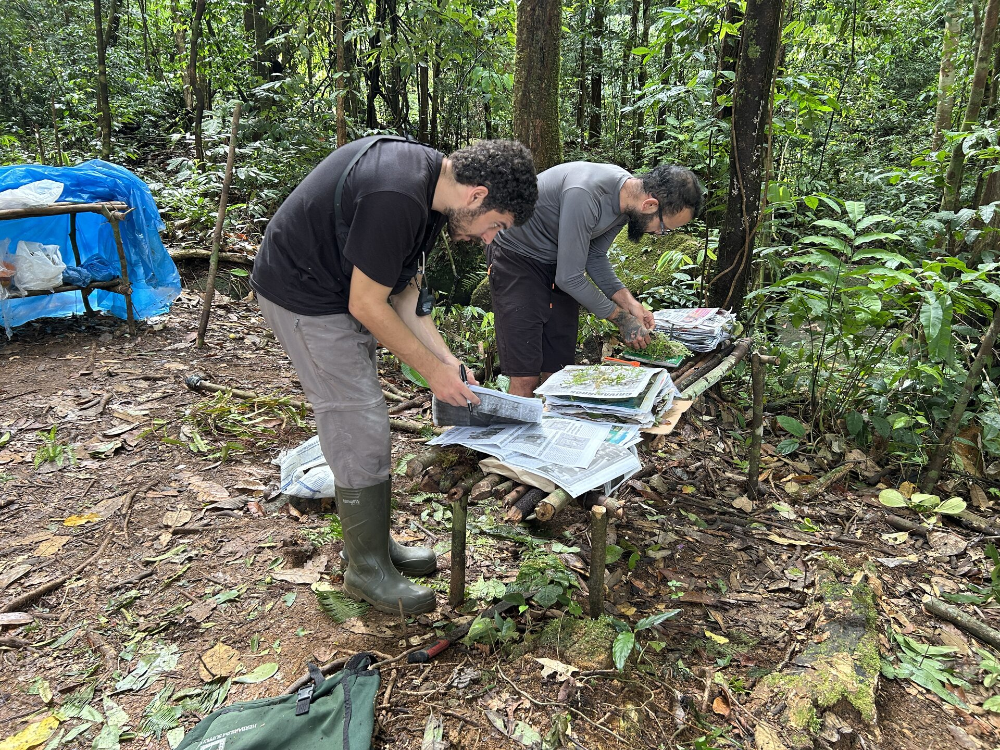
          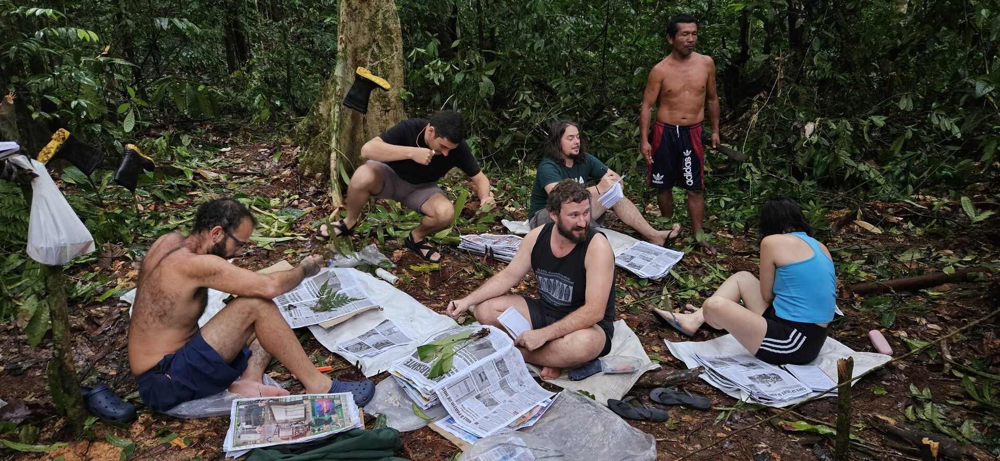
        </div>
        <div class="core-objective-body">
          <span class="core-objective-number">01</span>
          <span class="core-objective-kicker">Campo</span>
          <h3>Expedições nos rios Negro, Curicuriari, Içana e Vaupés</h3>
          <p>Campanhas de campo irão amostrar campinaranas, florestas de terra-firme, igapós, serras e afloramentos rochosos, com foco em plantas vasculares, criptógamas e fungos.</p>
        </div>
      </article>

      <article class="core-objective-card" data-objective-index="1" role="listitem">
        <div class="core-objective-media" aria-label="Imagens do Objetivo 2">
          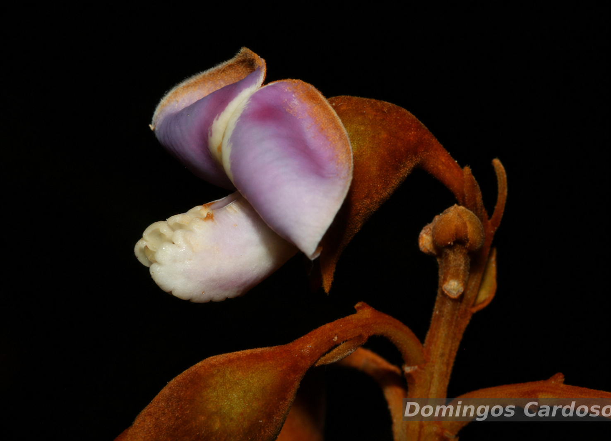
          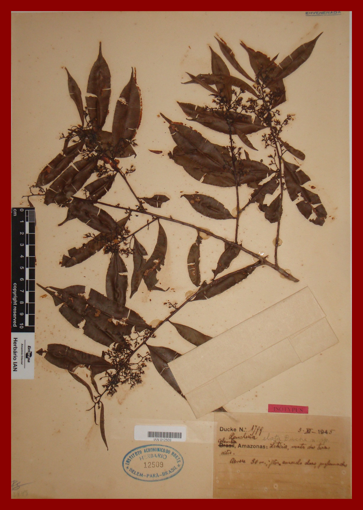
        </div>
        <div class="core-objective-body">
          <span class="core-objective-number">02</span>
          <span class="core-objective-kicker">Diversidade críptica e taxonomia integrativa</span>
          <h3>Revelar linhagens crípticas, raras e pouco conhecidas</h3>
          <p>Metabarcoding, dados moleculares, morfologia, coleções históricas e novas coletas serão integrados para detectar organismos pouco visíveis aos inventários tradicionais.</p>
        </div>
      </article>

      <article class="core-objective-card" data-objective-index="2" role="listitem">
        <div class="core-objective-media" aria-label="Imagens do Objetivo 3">
          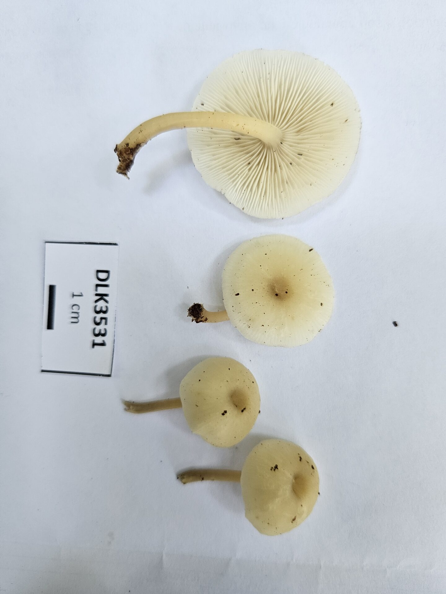
          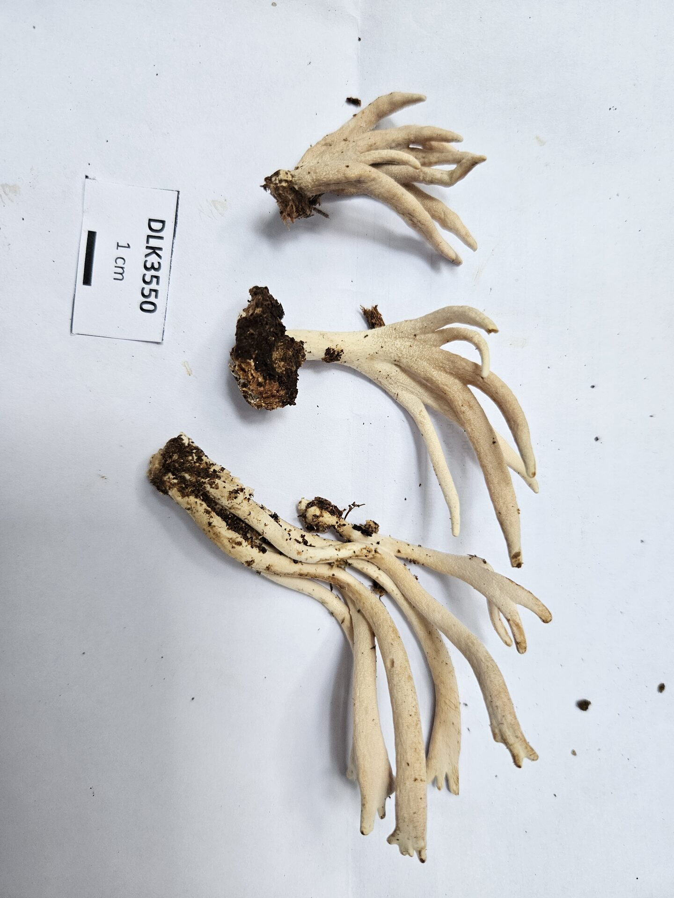
        </div>
        <div class="core-objective-body">
          <span class="core-objective-number">03</span>
          <span class="core-objective-kicker">Interações ecológicas</span>
          <h3>Fungos, hospedeiros e relações ecológicas complexas</h3>
          <p>A frente investiga a diversidade e evolução de fungos associados a insetos, ampliando o conhecimento sobre interações amazônicas ainda pouco documentadas.</p>
        </div>
      </article>

      <article class="core-objective-card" data-objective-index="3" role="listitem">
        <div class="core-objective-media" aria-label="Imagens do Objetivo 4">
          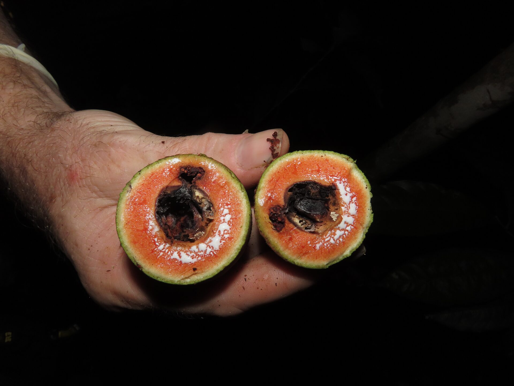
          
        </div>
        <div class="core-objective-body">
          <span class="core-objective-number">04</span>
          <span class="core-objective-kicker">Bioeconomia e segurança alimentar</span>
          <h3>PANC, nutrientes e metais em espécies de interesse local</h3>
          <p>Plantas alimentícias não convencionais, macro e micronutrientes e metais serão analisados conectando biodiversidade, alimentação, saúde ambiental e bioeconomia.</p>
        </div>
      </article>

      <article class="core-objective-card" data-objective-index="4" role="listitem">
        <div class="core-objective-media" aria-label="Imagens do Objetivo 5">
          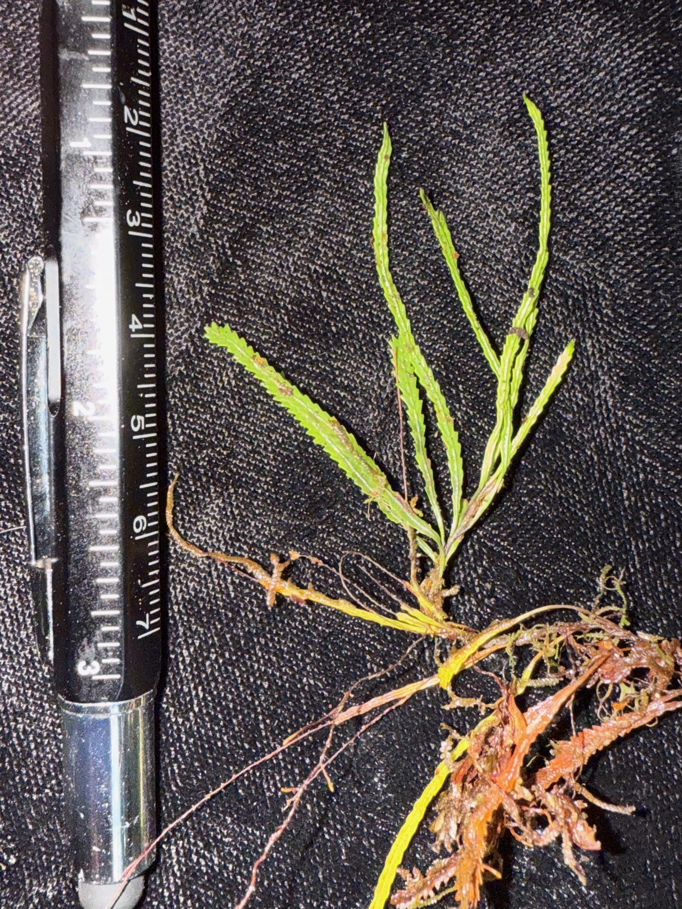
          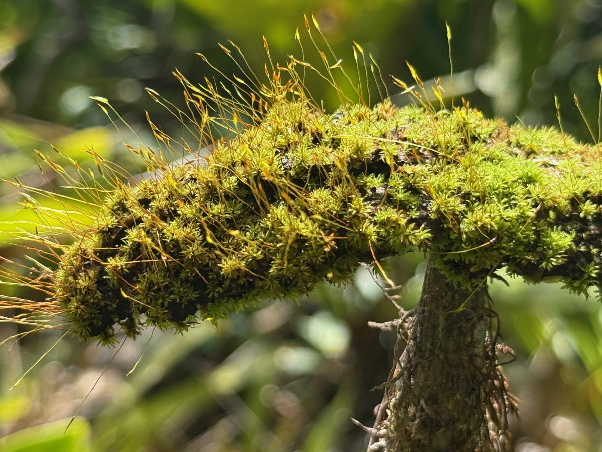
        </div>
        <div class="core-objective-body">
          <span class="core-objective-number">05</span>
          <span class="core-objective-kicker">Biomonitoramento</span>
          <h3>Bioindicadores para acompanhar qualidade ambiental</h3>
          <p>Musgos e outros grupos sensíveis serão usados para investigar contaminantes e criar uma base de referência para monitoramento ambiental em áreas indígenas.</p>
        </div>
      </article>

      <article class="core-objective-card" data-objective-index="5" role="listitem">
        <div class="core-objective-media" aria-label="Imagens do Objetivo 6">
          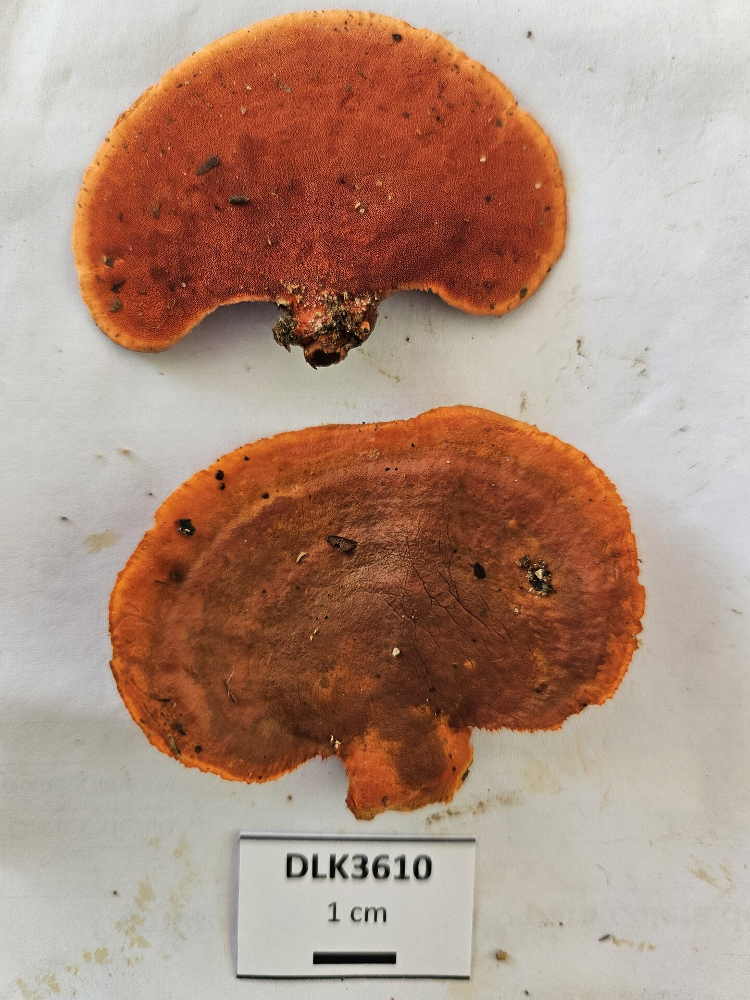
          
        </div>
        <div class="core-objective-body">
          <span class="core-objective-number">06</span>
          <span class="core-objective-kicker">Acervos e dados públicos</span>
          <h3>Catálogo verificado, herbários e banco AmaTreeDNA</h3>
          <p>As coletas irão fortalecer herbários amazônicos, apoiar a digitalização de espécimes e consolidar o primeiro catálogo da flora e funga da região.</p>
        </div>
      </article>

      <article class="core-objective-card" data-objective-index="6" role="listitem">
        <div class="core-objective-media" aria-label="Imagens do Objetivo 7">
          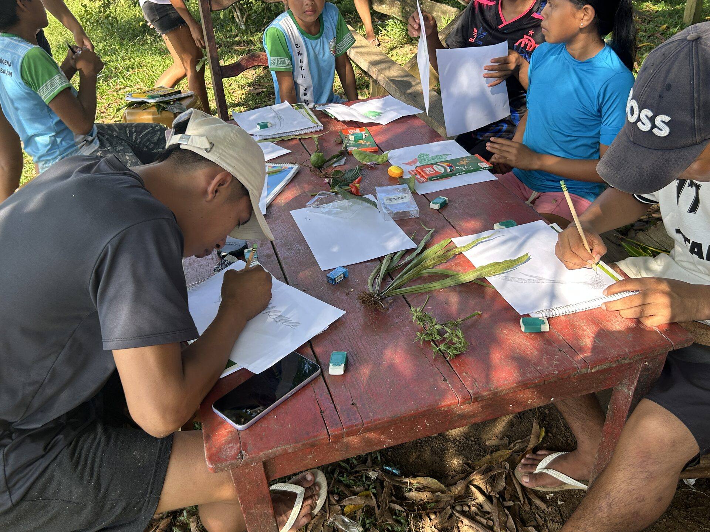
          
        </div>
        <div class="core-objective-body">
          <span class="core-objective-number">07</span>
          <span class="core-objective-kicker">Formação e comunicação</span>
          <h3>Oficinas, estudantes, parataxonomistas e comunicação multilíngue</h3>
          <p>Oficinas Botânicas, formação de estudantes, participação de parataxonomistas e tradução para Baniwa, Tukano e Nheengatu integram o retorno social do projeto.</p>
        </div>
      </article>

    </div>
  </div>
</section>
```

```{=html}
<section id="salvaguardas-cta" class="content-card method-section safeguards-section" aria-label="Salvaguardas socioambientais, PG, CTA, CGen, SisGen e Funai">
  <div class="section-title">
    <h2>Salvaguardas socioambientais</h2>
  </div>

  <div class="safeguards-editorial-card safeguards-wide-card">
    <figure class="safeguards-editorial-photo">
      
      <figcaption>SALVAGUARDA-1</figcaption>
    </figure>

    <div class="safeguards-editorial-copy">
    
      <div class="safeguards-editorial-textgrid">
        <p class="safeguards-editorial-lead">
          As atividades do Tsiino Hiiwiida são conduzidas com atenção aos direitos dos povos indígenas e comunidades detentoras de conhecimentos associados à biodiversidade. O projeto está amparado pelos procedimentos do CGen, com registros no SisGen para o acesso ao patrimônio genético e aos conhecimentos tradicionais associados, além da articulação com a Funai para as atividades em Terras Indígenas.
        </p>

        <p>
          Patrimônio Genético (PG) corresponde às informações genéticas presentes em plantas, fungos, microrganismos, amostras, tecidos, vouchers e materiais associados à biodiversidade brasileira. Conhecimento Tradicional Associado (CTA) envolve saberes, nomes, classificações, usos e relações com a biodiversidade compartilhados por povos indígenas e comunidades tradicionais.
        </p>

        <p>
          O CGen é o Conselho de Gestão do Patrimônio Genético, instância federal que orienta e regula o acesso a PG e CTA; o SisGen é o sistema nacional onde esses acessos são cadastrados e acompanhados. Para cada comunidade envolvida, o projeto organiza registros específicos de consentimento, CTA e SisGen, respeitando protocolos, formas próprias de representação, acordos comunitários e orientações da Funai.
        </p>

        <p>
          Essas salvaguardas explicitam a origem dos dados e amostras, fortalece a rastreabilidade científica, previne usos indevidos e orienta as devolutivas, a comunicação pública e eventuais repartições de benefícios quando aplicáveis.
        </p>
      </div>

      <div class="safeguards-editorial-tags" aria-label="Eixos de salvaguarda">
        <span>PG</span>
        <span>CTA</span>
        <span>CGen</span>
        <span>SisGen</span>
        <span>Funai</span>
      </div>
    </div>
  </div>
</section>
```


```{=html}
<section id="expedicoes-recentes" class="exp-collage-section" aria-label="Expedições recentes">
  <div class="exp-collage-grid" aria-label="Colagem com oito fotos das expedições">

    <figure class="exp-collage-item exp-photo-1" data-label="Expedição 1">
      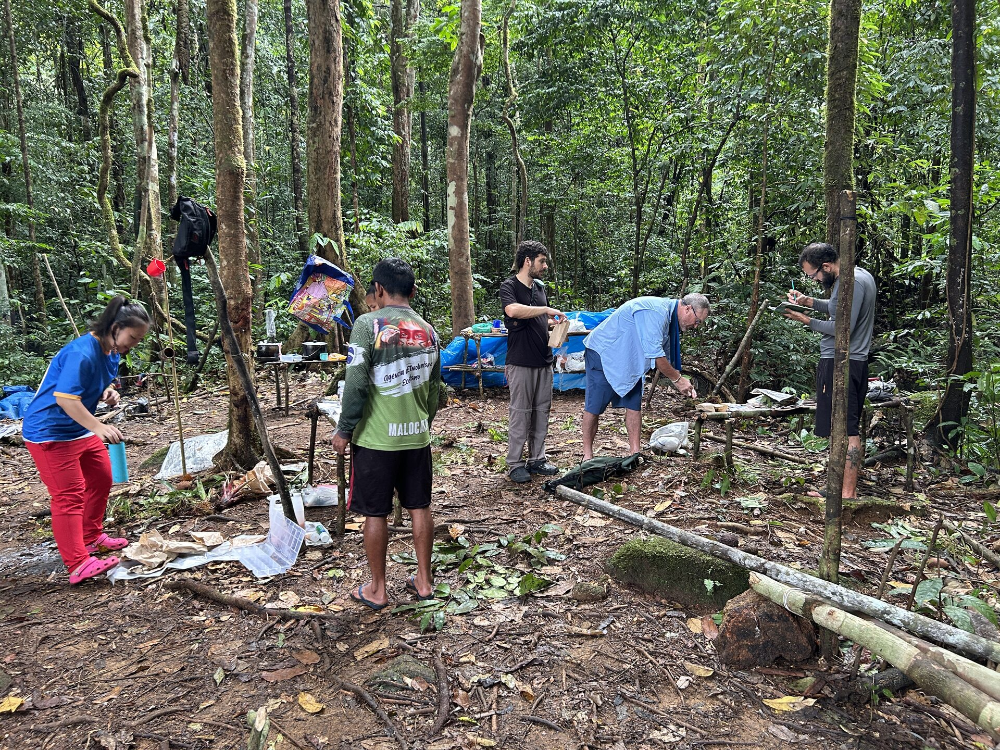
    </figure>

    <figure class="exp-collage-item exp-photo-2" data-label="Expedição 2">
      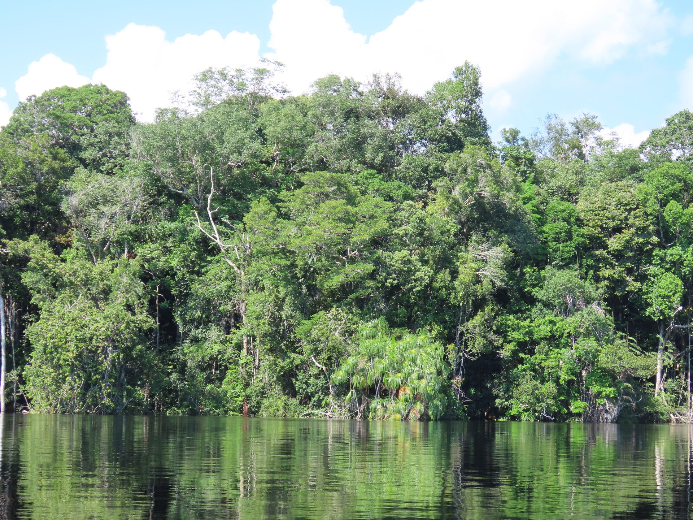
    </figure>

    <figure class="exp-collage-item exp-photo-3" data-label="Expedição 3">
      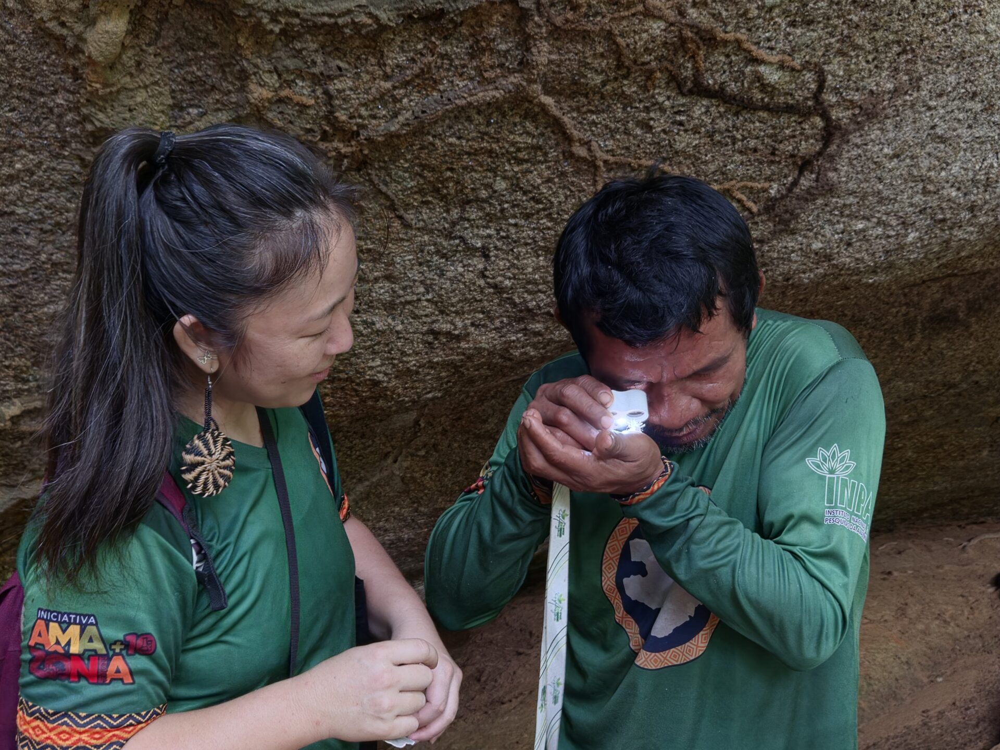
    </figure>

    <figure class="exp-collage-item exp-photo-4" data-label="Expedição 4">
      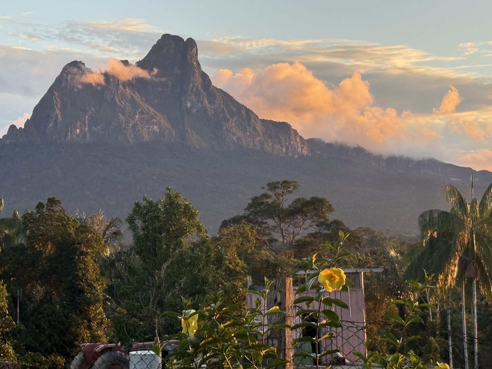
    </figure>

    <figure class="exp-collage-item exp-photo-5" data-label="Expedição 5">
      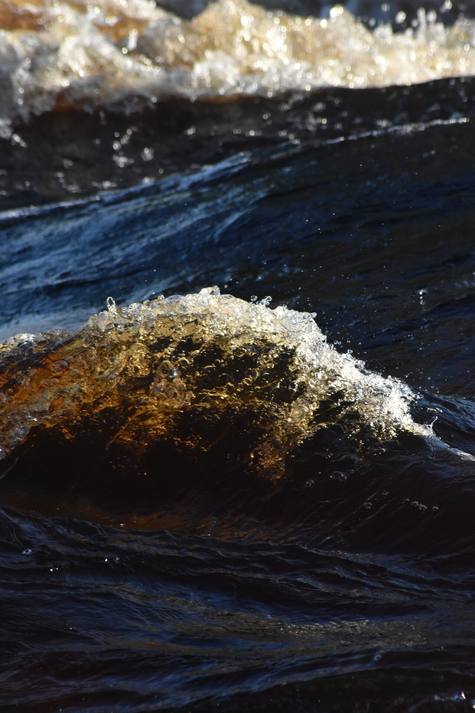
    </figure>

    <figure class="exp-collage-item exp-photo-6" data-label="Expedição 6">
      
    </figure>

    <figure class="exp-collage-item exp-photo-7" data-label="Expedição 7">
      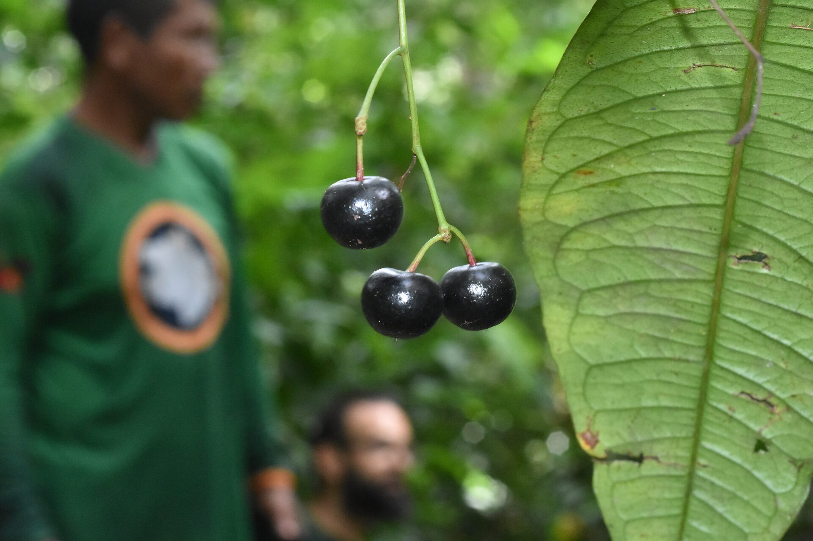
    </figure>

    <figure class="exp-collage-item exp-photo-8" data-label="Expedição 8">
      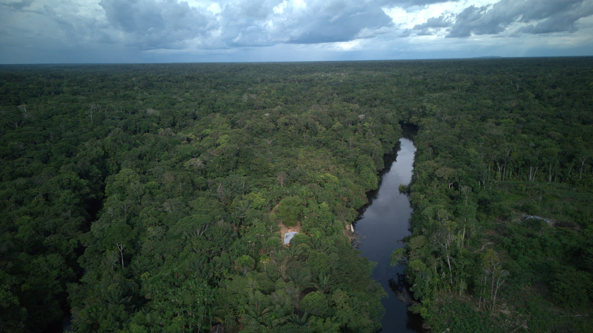
    </figure>

  </div>

  <div class="exp-collage-overlay">
    <div class="exp-collage-cta">
      <h2 class="exp-collage-heading">Expedições recentes</h2>
      <span class="exp-collage-line" aria-hidden="true"></span>
      <a class="btn-main" href="expedicoes/index.html">Mapa e fotos das expedições</a>
    </div>
  </div>
</section>


```

```{=html}


<script>
document.addEventListener("DOMContentLoaded", function () {
  const selectors = [
    "#o-projeto .section-title",
    "#o-projeto .about-eyebrow",
    "#o-projeto .about-display-title",
    "#o-projeto .lead",
    "#o-projeto .about-copy-columns p",
    "#o-projeto .about-pullquote",
    "#o-projeto .about-photo-expanded",
    "#o-projeto .about-map-compact",
    ".feature-title-wrap",
    ".feature-photo",
    ".feature-panel",
    ".method-intro-grid > *",
    ".method-step",
    ".impact-card",
    ".objective-slide.active .objective-text",
    ".objective-slide.active .objective-image-wrap",
    "#expedicoes-recentes .lead",
    "#divulgacao .lead",
    ".media-panel",
    ".researchers-copy",
    ".researcher-card"
  ];

  const revealTargets = Array.from(document.querySelectorAll(selectors.join(",")))
    .filter(el => !el.classList.contains("reveal-ready"));

  revealTargets.forEach((el, index) => {
    el.classList.add("reveal-ready");
    el.style.setProperty("--reveal-delay", `${Math.min(index % 8, 7) * 45}ms`);
  });

  if (window.matchMedia("(prefers-reduced-motion: reduce)").matches) {
    revealTargets.forEach(el => el.classList.add("is-visible"));
    return;
  }

  const observer = new IntersectionObserver(entries => {
    entries.forEach(entry => {
      if (entry.isIntersecting) {
        entry.target.classList.add("is-visible");
        observer.unobserve(entry.target);
      }
    });
  }, {
    threshold: 0.08,
    rootMargin: "0px 0px -6% 0px"
  });

  revealTargets.forEach(el => observer.observe(el));
});
</script>


<section id="divulgacao" class="content-card">
  <div class="section-title">
    <h2>Projeto Tsiino Hiiwiida na mídia</h2>
  </div>

  <p class="lead">
    Acompanhe a circulação pública do projeto Tsiino Hiiwiida.
  </p>
```

```{r divulgacao-dinamica}
library(htmltools)
library(rvest)
library(xml2)

get_meta_content <- function(doc, selectors) {
  for (selector in selectors) {
    value <- doc |> html_element(selector) |> html_attr("content")
    if (!is.na(value) && nzchar(trimws(value))) return(trimws(value))
  }
  ""
}

fetch_link_preview <- function(url) {
  empty <- list(titulo = "", descricao = "", imagem = "")
  if (!nz(url) || url == "#") return(empty)
  tryCatch({
    doc <- read_html(url)
    titulo <- get_meta_content(doc, c("meta[property='og:title']", "meta[name='twitter:title']"))
    if (!nz(titulo)) titulo <- doc |> html_element("title") |> html_text2()
    descricao <- get_meta_content(doc, c("meta[property='og:description']", "meta[name='twitter:description']", "meta[name='description']"))
    imagem <- get_meta_content(doc, c("meta[property='og:image']", "meta[property='og:image:secure_url']", "meta[name='twitter:image']"))
    if (nz(imagem)) imagem <- xml2::url_absolute(imagem, url)
    list(titulo = ifelse(is.na(titulo), "", titulo), descricao = ifelse(is.na(descricao), "", descricao), imagem = ifelse(is.na(imagem), "", imagem))
  }, error = function(e) empty)
}

read_media_csv <- function(rel_path, tipo) {
  data <- read_optional_csv(rel_path)
  if (nrow(data) == 0) return(data.frame())
  data.frame(
    tipo = rep(tipo, nrow(data)),
    url = col_or(data, c("url", "link", "href"), "#"),
    titulo = col_or(data, c("titulo", "título", "title", "post"), ""),
    imagem = col_or(data, c("imagem", "image", "thumb", "thumbnail", "capa"), ""),
    descricao = col_or(data, c("descricao", "descrição", "resumo", "caption", "texto"), ""),
    data_item = col_or(data, c("data", "date", "ano"), ""),
    veiculo = col_or(data, c("veiculo", "veículo", "fonte", "source"), ""),
    stringsAsFactors = FALSE
  )
}

media_items <- do.call(rbind, Filter(function(x) nrow(x) > 0, list(
  read_media_csv(file.path("_input_data", "divulgacao_instagram.csv"), "instagram"),
  read_media_csv(file.path("_input_data", "divulgacao_reportagens.csv"), "reportagem"),
  read_media_csv(file.path("_input_data", "divulgacao_youtube.csv"), "youtube")
)))

if (is.null(media_items) || nrow(media_items) == 0) {
  tags$div(class = "empty-media divulg-empty-media", "Nenhum item encontrado nos CSVs de divulgação. Ao adicionar linhas em _input_data/divulgacao_instagram.csv, _input_data/divulgacao_reportagens.csv ou _input_data/divulgacao_youtube.csv e renderizar o site novamente, o carrossel aparecerá aqui.")
} else {
  for (i in seq_len(nrow(media_items))) {
    preview <- fetch_link_preview(media_items$url[i])
    if (!nz(media_items$titulo[i])) media_items$titulo[i] <- preview$titulo
    if (!nz(media_items$descricao[i])) media_items$descricao[i] <- preview$descricao
    if (!nz(media_items$imagem[i])) media_items$imagem[i] <- preview$imagem
  }
  media_items$titulo[!nz(media_items$titulo)] <- "Projeto Tsiino Hiiwiida"
  parsed_dates <- suppressWarnings(as.Date(media_items$data_item))
  order_key <- ifelse(is.na(parsed_dates), as.Date("1900-01-01"), parsed_dates)
  media_items <- media_items[order(order_key, seq_len(nrow(media_items)), decreasing = TRUE), , drop = FALSE]

  make_slide <- function(i) {
    tipo <- media_items$tipo[i]
    tipo_label <- switch(tipo, instagram = "Instagram", reportagem = "Reportagem", youtube = "YouTube", "Mídia")
    link_label <- switch(tipo, instagram = "Ver Instagram →", reportagem = "Ler reportagem →", youtube = "Ver YouTube →", "Abrir link →")
    slide_class <- paste("carousel-slide", paste0("carousel-slide-", tipo), if (identical(tipo, "youtube")) "is-video" else "")
    thumb <- if (nz(media_items$imagem[i])) tags$div(class = "carousel-thumb", tags$img(src = media_items$imagem[i], alt = media_items$titulo[i], loading = "lazy")) else tags$div(class = "carousel-thumb carousel-thumb-fallback", tipo_label)
    tags$article(
      class = slide_class,
      thumb,
      if (identical(tipo, "youtube")) tags$div(class = "carousel-play-icon", "▶"),
      tags$div(
        class = "carousel-body",
        tags$span(class = paste("carousel-type-pill", if (identical(tipo, "reportagem")) "is-reportagem" else ""), tipo_label),
        if (nz(media_items$data_item[i])) tags$span(class = "carousel-date", media_items$data_item[i]),
        tags$p(class = "carousel-title", media_items$titulo[i]),
        if (nz(media_items$descricao[i])) tags$p(class = "carousel-description", media_items$descricao[i]),
        tags$a(class = "carousel-link", href = media_items$url[i], target = "_blank", rel = "noopener", link_label)
      )
    )
  }

  tagList(
    tags$div(
      class = "divulg-carousel-wrapper",
      `aria-label` = "Carrossel de divulgação",
      tags$button(class = "divulg-arrow divulg-prev", type = "button", `aria-label` = "Item anterior", "‹"),
      tags$div(class = "divulg-track-container", tags$div(class = "divulg-track", id = "divulg-track", lapply(seq_len(nrow(media_items)), make_slide))),
      tags$button(class = "divulg-arrow divulg-next", type = "button", `aria-label` = "Próximo item", "›"),
      tags$div(class = "divulg-dots", id = "divulg-dots", `aria-label` = "Navegação do carrossel")
    )
  )
}
```

```{=html}
</section>

<script>
(function(){
  document.addEventListener("DOMContentLoaded", function(){
    const track = document.getElementById("divulg-track");
    const dots = document.getElementById("divulg-dots");
    const wrapper = document.querySelector(".divulg-carousel-wrapper");
    if(!track || !dots || !wrapper) return;
    const slides = Array.from(track.querySelectorAll(".carousel-slide"));
    if(!slides.length) return;
    const perView = () => window.innerWidth <= 560 ? 1 : window.innerWidth <= 900 ? 2 : 3;
    let current = 0, timer = null;
    const totalGroups = () => Math.max(1, Math.ceil(slides.length / perView()));
    function buildDots(){
      dots.innerHTML = "";
      for(let i = 0; i < totalGroups(); i++){
        const btn = document.createElement("button");
        btn.type = "button";
        btn.className = "divulg-dot" + (i === current ? " active" : "");
        btn.setAttribute("aria-label", "Grupo " + (i + 1));
        btn.addEventListener("click", () => goTo(i, true));
        dots.appendChild(btn);
      }
    }
    function updateDots(){
      Array.from(dots.querySelectorAll(".divulg-dot")).forEach((d,i) => d.classList.toggle("active", i === current));
    }
    function goTo(index, resetTimer){
      const total = totalGroups();
      current = (index + total) % total;
      const slideWidth = slides[0].getBoundingClientRect().width;
      const gap = parseFloat(getComputedStyle(track).columnGap || getComputedStyle(track).gap || 0) || 0;
      track.style.transform = `translateX(-${current * perView() * (slideWidth + gap)}px)`;
      updateDots();
      if(resetTimer) restartAuto();
    }
    function stopAuto(){ if(timer) window.clearInterval(timer); timer = null; }
    function startAuto(){
      stopAuto();
      if(totalGroups() > 1 && !window.matchMedia("(prefers-reduced-motion: reduce)").matches){ timer = window.setInterval(() => goTo(current + 1, false), 5200); }
    }
    function restartAuto(){ stopAuto(); startAuto(); }
    document.querySelector(".divulg-prev")?.addEventListener("click", () => goTo(current - 1, true));
    document.querySelector(".divulg-next")?.addEventListener("click", () => goTo(current + 1, true));
    wrapper.addEventListener("mouseenter", stopAuto);
    wrapper.addEventListener("mouseleave", startAuto);
    wrapper.addEventListener("focusin", stopAuto);
    wrapper.addEventListener("focusout", startAuto);
    window.addEventListener("resize", () => { current = 0; buildDots(); goTo(0, false); restartAuto(); });
    buildDots(); goTo(0, false); startAuto();
  });
})();
</script>
```

```{=html}
<section id="pesquisadores-responsaveis" class="content-card researchers-section">
  <div class="section-title">
    <h2>Rede de coordenação científica</h2>
  </div>

  <div class="researchers-layout">
    <div class="researchers-copy">
      <div class="researchers-kicker">Rede de coordenação científica</div>

      <p class="lead researchers-lead">
        O projeto é coordenado por uma rede multidisciplinar vinculada a instituições amazônicas, centros de pesquisa de outros estados brasileiros e parceiros do Reino Unido.
      </p>

      <p>
        A rede combina taxonomia, sistemática, bioinformática, micologia, briologia, florística, química de solos, comunicação científica, audiovisual e colaboração com parataxonomistas e representantes indígenas.
      </p>

      <div class="researchers-summary">
        <div>
          <span class="researchers-number">30</span>
          <span class="researchers-label">instituições articuladas</span>
        </div>

        <div>
          <span class="researchers-number">66</span>
          <span class="researchers-label">pesquisadores, estudantes e equipe técnica</span>
        </div>
      </div>

      <div class="hero-actions researchers-actions">
        <a class="btn-main" href="team/">Conhecer a equipe completa</a>
      </div>
    </div>

    <div class="researchers-panel">
      <div class="researchers-panel-header">
        <h3></h3>
      </div>

      <div class="researchers-list">
        <article class="researcher-card">
          <span class="agency-pill">FAPEAM</span>
          <h4>Charles Zartman</h4>
          <p>Instituto Nacional de Pesquisas da Amazônia — INPA</p>
        </article>

        <article class="researcher-card">
          <span class="agency-pill">FAPERJ</span>
          <h4>Domingos Cardoso</h4>
          <p>Jardim Botânico do Rio de Janeiro — JBRJ</p>
        </article>

        <article class="researcher-card">
          <span class="agency-pill">UKRI</span>
          <h4>Sandra Diane Knapp</h4>
          <p>Natural History Museum</p>
        </article>

        <article class="researcher-card">
          <span class="agency-pill">FAPESPA</span>
          <h4>Anna Luiza Ilkiu-Borges</h4>
          <p>Museu Paraense Emílio Goeldi — MPEG</p>
        </article>

        <article class="researcher-card">
          <span class="agency-pill">FACEPE</span>
          <h4>Clístenes Nascimento</h4>
          <p>Universidade Federal Rural de Pernambuco — UFRPE</p>
        </article>

        <article class="researcher-card">
          <span class="agency-pill">FAPEMA</span>
          <h4>Dirce Komura</h4>
          <p>Instituto Nacional de Pesquisas da Amazônia — INPA</p>
        </article>

        <article class="researcher-card">
          <span class="agency-pill">FAPESP</span>
          <h4>Denilson Peralta</h4>
          <p>Instituto de Pesquisas Ambientais — IPA</p>
        </article>

        <article class="researcher-card">
          <span class="agency-pill">FAPESQ</span>
          <h4>Felipe Wartchow</h4>
          <p>Universidade Federal da Paraíba — UFPB</p>
        </article>

        <article class="researcher-card">
          <span class="agency-pill">FAPDF</span>
          <h4>Micheline Carvalho-Silva</h4>
          <p>Universidade de Brasília — UnB</p>
        </article>
      </div>
    </div>
  </div>
</section>
```

```{r instituicoes-projeto, results='asis'}
library(htmltools)

inst_path <- find_up(file.path("_input_data", "institutions.yml"))

as_chr <- function(x, default = "") {
  if (is.null(x) || length(x) == 0 || all(is.na(x))) return(default)
  x <- as.character(x[[1]])
  if (is.na(x) || !nzchar(trimws(x))) default else x
}

as_int <- function(x, default = 999L) {
  out <- suppressWarnings(as.integer(as_chr(x, as.character(default))))
  if (is.na(out)) default else out
}

read_institutions_yml <- function(path) {
  if (is.na(path) || !file.exists(path)) return(data.frame())
  if (!requireNamespace("yaml", quietly = TRUE)) return(data.frame())
  raw <- yaml::read_yaml(path)
  if (length(raw) == 0) return(data.frame())
  rows <- lapply(seq_along(raw), function(i) {
    item <- raw[[i]]
    data.frame(
      id = as_chr(item$id, paste0("inst_", i)),
      group = as_chr(item$group, "parceira"),
      order = as_int(item$order, i),
      acronym = as_chr(item$acronym, as_chr(item$id, paste0("INST ", i))),
      name = as_chr(item$name, as_chr(item$acronym, "Instituição")),
      role = as_chr(item$role, "Instituição"),
      url = as_chr(item$url, ""),
      logo = as_chr(item$logo, ""),
      status = as_chr(item$status, ""),
      note = as_chr(item$note, ""),
      stringsAsFactors = FALSE
    )
  })
  do.call(rbind, rows)
}

institutions <- read_institutions_yml(inst_path)

if (nrow(institutions) == 0) {
  tags$section(id = "logos-institucionais", class = "logos-strip", `aria-label` = "Logos institucionais", tags$div(class = "empty-media", "Nenhum cadastro institucional foi encontrado em _input_data/institutions.yml."))
} else {
  institutions <- institutions[order(match(institutions$group, c("fomento", "participante", "parceira")), institutions$order, institutions$name), , drop = FALSE]
  fomento_data <- institutions[institutions$group == "fomento", , drop = FALSE]
  cnpq_row <- institutions[institutions$id == "cnpq", , drop = FALSE]
  fomento_display <- unique(rbind(fomento_data, cnpq_row))
  participante_data <- institutions[institutions$group == "participante", , drop = FALSE]
  parceira_data <- institutions[institutions$group == "parceira" & institutions$id != "cnpq", , drop = FALSE]

  make_logo_item <- function(data, i) {
    content <- list(
      if (nz(data$logo[i])) tags$img(src = data$logo[i], alt = paste("Logo", data$acronym[i]), loading = "lazy", onerror = "this.style.display='none'; this.parentElement.classList.add('logo-missing');"),
      tags$span(class = "logo-fallback", data$acronym[i])
    )
    if (nz(data$url[i]) && grepl("^https?://", data$url[i])) {
      tags$a(href = data$url[i], target = "_blank", rel = "noopener", class = "logo-item", `aria-label` = paste(data$acronym[i], "—", data$name[i]), content)
    } else {
      tags$span(class = "logo-item", `aria-label` = paste(data$acronym[i], "—", data$name[i]), content)
    }
  }

  make_logo_group <- function(title, data) {
    tags$div(
      class = "logos-group",
      tags$h3(class = "logos-group-title", title),
      if (nrow(data) == 0) tags$div(class = "empty-media", "Nenhuma instituição cadastrada neste grupo.") else tags$div(class = "logos-row", lapply(seq_len(nrow(data)), function(i) make_logo_item(data, i)))
    )
  }

  tags$section(
    id = "logos-institucionais",
    class = "logos-strip",
    `aria-label` = "Logos institucionais",
    make_logo_group("Financiadores", fomento_display),
    make_logo_group("Instituições participantes", participante_data),
    make_logo_group("Instituições parceiras", parceira_data)
  )
}
```


```{=html}

<script>
(function () {
  document.addEventListener("DOMContentLoaded", function () {
    const root = document.getElementById("objetivos");
    if (!root || root.dataset.objectivesCarouselReady === "1") return;
    root.dataset.objectivesCarouselReady = "1";

    const viewport = root.querySelector(".core-objectives-viewport");
    const track = root.querySelector(".core-objectives-track");
    const cards = Array.from(root.querySelectorAll(".core-objective-card"));
    const prev = root.querySelector(".core-objectives-prev");
    const next = root.querySelector(".core-objectives-next");

    if (!viewport || !track || !cards.length) return;

    let activeIndex = 0;
    let photoTimer = null;
    let autoTimer = null;
    let ticking = false;
    let pointerStartX = null;
    let pointerStartY = null;
    let carouselHasEnteredViewport = false;

    const AUTO_DELAY = 5000;
    const prefersReducedMotion = window.matchMedia("(prefers-reduced-motion: reduce)");

    function wrap(index) {
      return (index + cards.length) % cards.length;
    }

    function stopAuto() {
      if (autoTimer) {
        clearTimeout(autoTimer);
        autoTimer = null;
      }
    }

    function scheduleAuto() {
      stopAuto();
      if (!carouselHasEnteredViewport || prefersReducedMotion.matches || cards.length <= 1) return;

      autoTimer = setTimeout(function () {
        setActive(activeIndex + 1, false, "auto");
      }, AUTO_DELAY);
    }

    function getGap() {
      const styles = window.getComputedStyle(track);
      const gapValue = styles.columnGap || styles.gap || "0";
      return Number.parseFloat(gapValue) || 0;
    }

    function classifyCards() {
      cards.forEach(function (card, i) {
        const distance = i - activeIndex;

        card.classList.toggle("is-active", distance === 0);
        card.classList.toggle("is-next", distance === 1);
        card.classList.toggle("is-far", distance === 2);
        card.classList.toggle("is-after", distance > 2);
        card.classList.toggle("is-before", distance < 0);

        card.setAttribute("aria-current", distance === 0 ? "true" : "false");
        card.setAttribute("tabindex", distance === 0 ? "0" : "-1");
      });
    }

    function resetPhotos(card) {
      cards.forEach(function (item) {
        const photos = Array.from(item.querySelectorAll(".core-objective-photo"));
        photos.forEach(function (photo, i) {
          photo.classList.toggle("is-photo-active", i === 0);
        });
        item.dataset.photoIndex = "0";
      });

      if (photoTimer) {
        clearInterval(photoTimer);
        photoTimer = null;
      }

      const activePhotos = Array.from(card.querySelectorAll(".core-objective-photo"));
      if (activePhotos.length <= 1 || prefersReducedMotion.matches) return;

      photoTimer = setInterval(function () {
        const current = Number(card.dataset.photoIndex || 0);
        const nextPhoto = (current + 1) % activePhotos.length;
        card.dataset.photoIndex = String(nextPhoto);

        activePhotos.forEach(function (photo, i) {
          photo.classList.toggle("is-photo-active", i === nextPhoto);
        });
      }, 3600);
    }

    function alignActiveCard() {
      const activeCard = cards[activeIndex];
      if (!activeCard) return;

      const viewportWidth = viewport.clientWidth;
      const activeWidth = activeCard.getBoundingClientRect().width || activeCard.offsetWidth;

      /*
        Alinhamento estável:
        - index 0: card centralizado, com vazio à esquerda.
        - index > 0: o ativo também se centraliza; o card anterior toca/sai pela
          borda esquerda e o próximo entra pela borda direita, sem padding lateral.
        Como a largura dos cards não muda por classe, não há salto no meio da transição.
      */
      const target = (viewportWidth - activeWidth) / 2 - activeCard.offsetLeft;
      track.style.transform = "translate3d(" + target + "px, 0, 0)";
    }

    function requestAlign() {
      if (ticking) return;
      ticking = true;
      window.requestAnimationFrame(function () {
        ticking = false;
        alignActiveCard();
      });
    }

    function setActive(index, shouldFocus, source) {
      const previous = activeIndex;
      activeIndex = wrap(index);

      /* Evita a volta animada longa do último para o primeiro. */
      if (source === "auto" && previous === cards.length - 1 && activeIndex === 0) {
        track.style.transition = "none";
        classifyCards();
        resetPhotos(cards[activeIndex]);
        alignActiveCard();
        window.requestAnimationFrame(function () {
          track.style.transition = "";
        });
        scheduleAuto();
        return;
      }

      classifyCards();
      resetPhotos(cards[activeIndex]);
      requestAlign();

      if (shouldFocus) cards[activeIndex].focus({ preventScroll: true });
      scheduleAuto();
    }

    cards.forEach(function (card, i) {
      card.addEventListener("click", function () {
        carouselHasEnteredViewport = true;
        setActive(i, false, "click-card");
      });

      card.addEventListener("keydown", function (event) {
        if (event.key === "Enter" || event.key === " ") {
          event.preventDefault();
          carouselHasEnteredViewport = true;
          setActive(i, true, "keyboard-card");
        }
      });
    });

    if (prev) {
      prev.addEventListener("click", function () {
        carouselHasEnteredViewport = true;
        setActive(activeIndex - 1, false, "prev");
      });
    }

    if (next) {
      next.addEventListener("click", function () {
        carouselHasEnteredViewport = true;
        setActive(activeIndex + 1, false, "next");
      });
    }

    viewport.addEventListener("keydown", function (event) {
      if (event.key === "ArrowRight") {
        event.preventDefault();
        carouselHasEnteredViewport = true;
        setActive(activeIndex + 1, false, "keyboard-next");
      }

      if (event.key === "ArrowLeft") {
        event.preventDefault();
        carouselHasEnteredViewport = true;
        setActive(activeIndex - 1, false, "keyboard-prev");
      }

      if (event.key === "Home") {
        event.preventDefault();
        carouselHasEnteredViewport = true;
        setActive(0, false, "keyboard-home");
      }

      if (event.key === "End") {
        event.preventDefault();
        carouselHasEnteredViewport = true;
        setActive(cards.length - 1, false, "keyboard-end");
      }
    });

    viewport.addEventListener("pointerdown", function (event) {
      pointerStartX = event.clientX;
      pointerStartY = event.clientY;
      viewport.classList.add("is-dragging");
      stopAuto();
    }, { passive: true });

    viewport.addEventListener("pointerup", function (event) {
      if (pointerStartX === null || pointerStartY === null) {
        viewport.classList.remove("is-dragging");
        scheduleAuto();
        return;
      }

      const dx = event.clientX - pointerStartX;
      const dy = event.clientY - pointerStartY;
      viewport.classList.remove("is-dragging");

      if (Math.abs(dx) > 44 && Math.abs(dx) > Math.abs(dy) * 1.15) {
        carouselHasEnteredViewport = true;
        setActive(activeIndex + (dx < 0 ? 1 : -1), false, "swipe");
      } else {
        scheduleAuto();
      }

      pointerStartX = null;
      pointerStartY = null;
    }, { passive: true });

    viewport.addEventListener("pointercancel", function () {
      pointerStartX = null;
      pointerStartY = null;
      viewport.classList.remove("is-dragging");
      scheduleAuto();
    }, { passive: true });

    window.addEventListener("resize", requestAlign, { passive: true });

    if (window.ResizeObserver) {
      const ro = new ResizeObserver(requestAlign);
      ro.observe(root);
      ro.observe(viewport);
      ro.observe(track);
    }

    if (document.fonts && document.fonts.ready) {
      document.fonts.ready.then(requestAlign);
    }

    if ("IntersectionObserver" in window) {
      const autoObserver = new IntersectionObserver(function (entries) {
        entries.forEach(function (entry) {
          if (entry.isIntersecting) {
            carouselHasEnteredViewport = true;
            scheduleAuto();
          } else {
            stopAuto();
          }
        });
      }, {
        threshold: 0.35,
        rootMargin: "0px 0px -8% 0px"
      });
      autoObserver.observe(root);
    } else {
      carouselHasEnteredViewport = true;
      scheduleAuto();
    }

    window.addEventListener("load", requestAlign);

    classifyCards();
    resetPhotos(cards[activeIndex]);
    requestAlign();
  });
})();
</script>
```

```{=html}

<script>
(function () {
  document.addEventListener("DOMContentLoaded", function () {
    const root = document.getElementById("objetivos");
    if (!root || root.dataset.objectiveDotsReady === "1") return;
    root.dataset.objectiveDotsReady = "1";

    const cards = Array.from(root.querySelectorAll(".core-objective-card"));
    let dots = Array.from(root.querySelectorAll(".core-objectives-dot"));

    if (!cards.length) return;

    if (!dots.length) {
      const dotbar = document.createElement("div");
      dotbar.className = "core-objectives-dots";
      dotbar.setAttribute("aria-label", "Navegação por objetivos");

      cards.forEach(function (_card, i) {
        const dot = document.createElement("button");
        dot.className = "core-objectives-dot" + (i === 0 ? " is-active" : "");
        dot.type = "button";
        dot.dataset.objectiveDot = String(i);
        dot.setAttribute("aria-label", "Ir para o objetivo " + (i + 1));
        dotbar.appendChild(dot);
      });

      const viewport = root.querySelector(".core-objectives-viewport");
      if (viewport && viewport.parentNode) viewport.parentNode.insertBefore(dotbar, viewport);
      dots = Array.from(dotbar.querySelectorAll(".core-objectives-dot"));
    }

    function syncDots() {
      const activeIndex = cards.findIndex(function (card) {
        return card.classList.contains("is-active");
      });

      dots.forEach(function (dot, i) {
        const isActive = i === activeIndex;
        dot.classList.toggle("is-active", isActive);
        dot.setAttribute("aria-current", isActive ? "true" : "false");
      });
    }

    dots.forEach(function (dot, i) {
      dot.addEventListener("click", function () {
        if (cards[i]) cards[i].click();
        window.requestAnimationFrame(syncDots);
      });
    });

    const observer = new MutationObserver(syncDots);
    cards.forEach(function (card) {
      observer.observe(card, { attributes: true, attributeFilter: ["class"] });
    });

    syncDots();
  });
})();
</script>
```


