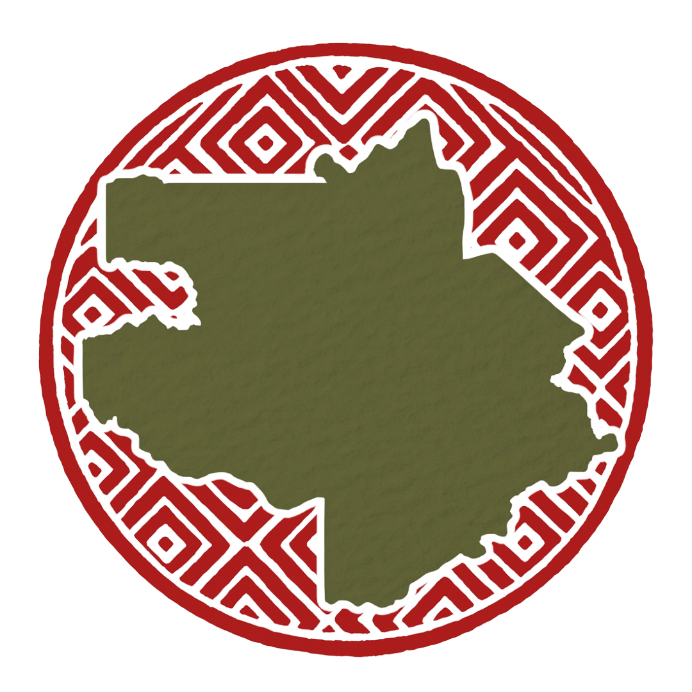

```{r setup, include=FALSE}
knitr::opts_chunk$set(echo = FALSE, warning = FALSE, message = FALSE)

library(dplyr)
library(stringr)
library(htmltools)
library(openxlsx)

find_up <- function(rel_path, start = getwd(), max_levels = 8) {
  d <- normalizePath(start, winslash = "/", mustWork = FALSE)
  for (i in 0:max_levels) {
    cand <- file.path(d, rel_path)
    if (file.exists(cand)) return(cand)
    parent <- dirname(d)
    if (identical(parent, d)) break
    d <- parent
  }
  NA_character_
}

nz <- function(x) {
  !is.na(x) & nzchar(trimws(as.character(x)))
}

safe_html <- function(x) {
  x <- as.character(x)
  x[is.na(x) | trimws(x) == ""] <- "—"
  htmltools::htmlEscape(x)
}

slugify <- function(x) {
  x <- as.character(x)
  x[is.na(x) | trimws(x) == ""] <- "membro"
  x <- iconv(x, from = "UTF-8", to = "ASCII//TRANSLIT")
  x <- tolower(x)
  x <- gsub("[^a-z0-9]+", "-", x)
  x <- gsub("(^-+|-+$)", "", x)
  x[x == ""] <- "membro"
  make.unique(x, sep = "-")
}

normalize_name <- function(x) {
  x <- as.character(x)
  x <- iconv(x, from = "UTF-8", to = "ASCII//TRANSLIT")
  x <- tolower(x)
  x <- gsub("[^a-z0-9]+", " ", x)
  x <- trimws(gsub("\\s+", " ", x))
  x
}

normalize_col_id <- function(x) {
  x <- as.character(x)
  x <- iconv(x, from = "UTF-8", to = "ASCII//TRANSLIT")
  x <- tolower(x)
  x <- gsub("[^a-z0-9]+", "", x)
  x
}

get_col <- function(data, candidates, required = TRUE, label = NULL) {
  hit <- intersect(candidates, names(data))
  if (length(hit) > 0) return(hit[1])

  data_names_norm <- normalize_col_id(names(data))
  candidates_norm <- normalize_col_id(candidates)
  hit_norm <- which(data_names_norm %in% candidates_norm)
  if (length(hit_norm) > 0) return(names(data)[hit_norm[1]])

  if (required) {
    stop(
      "Não encontrei a coluna ", ifelse(is.null(label), paste(candidates, collapse = "/"), label), ".\n",
      "Colunas disponíveis no input: ", paste(names(data), collapse = ", ")
    )
  }
  NA_character_
}

get_value <- function(row, possible_names, default = "") {
  for (name in possible_names) {
    if (name %in% names(row)) {
      value <- row[[name]][1]
      if (!is.na(value) && nzchar(trimws(as.character(value)))) {
        return(as.character(value))
      }
    }
  }

  row_names_norm <- normalize_col_id(names(row))
  possible_norm <- normalize_col_id(possible_names)
  hit <- which(row_names_norm %in% possible_norm)

  if (length(hit) > 0) {
    value <- row[[hit[1]]][1]
    if (!is.na(value) && nzchar(trimws(as.character(value)))) {
      return(as.character(value))
    }
  }

  default
}

normalize_photo_stem <- function(x) {
  x <- basename(as.character(x))
  x <- tools::file_path_sans_ext(x)
  x <- iconv(x, from = "UTF-8", to = "ASCII//TRANSLIT")
  x <- tolower(x)
  x <- gsub("[^a-z0-9]+", "_", x)
  x <- gsub("_+", "_", x)
  x <- gsub("^_|_$", "", x)
  x
}

find_photo_filename <- function(member_name, photo_dir) {

  files <- list.files(
    photo_dir,
    pattern = "\\.(jpg|jpeg|png)$",
    ignore.case = TRUE
  )

  if (length(files) == 0) {
    return(NA_character_)
  }

  member_key <- normalize_photo_stem(member_name)
  file_keys <- normalize_photo_stem(files)

  hit <- files[file_keys == member_key]

  if (length(hit) == 0) {
    return(NA_character_)
  }

  hit[1]
}

team_path <- find_up(file.path("_input_data", "tsiino_hiiwiida_team.xlsx"))
if (is.na(team_path)) {
  stop("Não encontrei o arquivo '_input_data/tsiino_hiiwiida_team.xlsx'.")
}

team_data <- openxlsx::read.xlsx(team_path)
names(team_data) <- make.names(names(team_data))

member_col <- get_col(team_data, c("Member", "Nome", "Name", "Membro", "Pessoa"), label = "nome do membro")
if (member_col != "Member") {
  team_data$Member <- as.character(team_data[[member_col]])
}
team_data$Member <- trimws(as.character(team_data$Member))
team_data <- team_data[nz(team_data$Member), , drop = FALSE]
# Remove linhas idênticas da planilha (ex.: "Vitor Hugo Andrade Oliveira" repetido)
team_data <- team_data[!duplicated(team_data), , drop = FALSE]

photo_dir_abs <- file.path(dirname(team_path), "tsiino_team_images")
photo_dir_html <- "../_input_data/tsiino_team_images"

default_candidates <- c("default.jpg", "default.jpeg", "default.png")
default_file <- default_candidates[file.exists(file.path(photo_dir_abs, default_candidates))][1]
if (is.na(default_file)) default_file <- "default.jpg"

team_data <- team_data |>
  mutate(
    member_key = normalize_name(Member),
    member_slug = slugify(Member),
    first_letter = toupper(substr(normalize_name(Member), 1, 1)),
    
    photo_file = vapply(
      Member,
      find_photo_filename,
      character(1),
      photo_dir = photo_dir_abs
    ),
    
    photo_path = ifelse(
      !is.na(photo_file),
      file.path(photo_dir_html, photo_file),
      file.path(photo_dir_html, default_file)
    ) |>
      gsub("\\\\", "/", x = _)
  )

responsible_names <- c(
  "Charles Zartman",
  "Domingos Cardoso",
  "Sandra Diane Knapp",
  "Anna Luiza Ilkiu-Borges",
  "Clístenes Nascimento",
  "Dirce Komura",
  "Denilson Peralta",
  "Felipe Wartchow",
  "Leandro Giacomin",
  "Micheline Carvalho-Silva"
)

responsible_keys <- normalize_name(responsible_names)
team_data$responsible_rank <- match(team_data$member_key, responsible_keys)

# Classificação dos bolsistas indígenas diretamente pelo campo "Cargo no projeto".
# Entra nesta categoria somente quando o texto do cargo contém, ao mesmo tempo,
# as palavras "bolsista" e "comunidade" (sem depender de maiúsculas ou acentos).
project_role_col <- get_col(
  team_data,
  c(
    "Cargo no projeto",
    "Cargo.no.projeto",
    "Cargo",
    "Participacao no projeto",
    "Participação no projeto",
    "Participacao.no.projeto",
    "Participação.no.projeto",
    "Participacao",
    "Participação",
    "Funcao no projeto",
    "Função no projeto",
    "Funcao.no.projeto",
    "Função.no.projeto",
    "Funcao",
    "Função",
    "Project role",
    "Project.Role",
    "ProjectRole",
    "Role"
  ),
  required = FALSE
)

if (!is.na(project_role_col)) {
  team_data$project_role_raw <- as.character(team_data[[project_role_col]])
} else {
  team_data$project_role_raw <- ""
}

team_data$project_role_raw[is.na(team_data$project_role_raw)] <- ""
team_data$project_role_key <- normalize_name(team_data$project_role_raw)

team_data$is_bolsista <-
  grepl("bolsista", team_data$project_role_key, fixed = TRUE)

team_data$is_bolsista_indigena <-
  team_data$is_bolsista &
  grepl("comunidade", team_data$project_role_key, fixed = TRUE)

team_data$is_bolsista_instituicao <-
  team_data$is_bolsista &
  !grepl("comunidade", team_data$project_role_key, fixed = TRUE)

# Prioridade de exibição:
# 1. coordenação
# 2. bolsistas indígenas: cargo contém "bolsista" + "comunidade"
# 3. bolsistas das instituições: cargo contém "bolsista" e não contém "comunidade"
# 4. equipe ampliada
team_data$team_role <- dplyr::case_when(
  !is.na(team_data$responsible_rank) ~ "responsavel",
  team_data$is_bolsista_indigena ~ "bolsista_indigena",
  team_data$is_bolsista_instituicao ~ "bolsista_instituicao",
  TRUE ~ "integrante"
)

responsaveis <- team_data |>
  filter(team_role == "responsavel") |>
  arrange(responsible_rank, Member)

bolsistas_indigenas <- team_data |>
  filter(team_role == "bolsista_indigena") |>
  arrange(Member)

bolsistas_instituicoes <- team_data |>
  filter(team_role == "bolsista_instituicao") |>
  arrange(Member)

integrantes <- team_data |>
  filter(team_role == "integrante") |>
  arrange(Member)

team_ordered <- bind_rows(
  responsaveis,
  bolsistas_indigenas,
  bolsistas_instituicoes,
  integrantes
)
```

```{=html}
<link rel="preconnect" href="https://fonts.googleapis.com">
<link rel="preconnect" href="https://fonts.gstatic.com" crossorigin>
<link href="https://fonts.googleapis.com/css2?family=Montserrat:wght@400;500;600;700;800;900&family=Source+Serif+4:opsz,wght@8..60,400;8..60,600;8..60,700&family=Space+Mono:wght@400;700&display=swap" rel="stylesheet">

<link rel="stylesheet" href="../assets/css/pages/equipe.css">
<link rel="stylesheet" href="../assets/css/tsiino-base.css">
```

```{=html}
<section class="page-hero page-hero-team" aria-label="Abertura da página da equipe">
  <div class="page-hero-overlay"></div>

  <div class="page-hero-logo" aria-label="Logo Tsiino Hiiwiida">
    
  </div>

  <div class="page-hero-content">
    <div class="hero-kicker">Equipe científica · Tsiino Hiiwiida</div>
    <h1>Equipe</h1>
    <p class="hero-subtitle">Pesquisadores, instituições e colaboradores do projeto</p>
    <p class="hero-description">
    </p>

    <div class="hero-actions">
      <a class="btn-main" href="#pesquisadores-responsaveis">Coordenação</a>
      <a class="btn-main btn-bolsista-indigena" href="#bolsistas-indigenas">Bolsistas indígenas</a>
      <a class="btn-main btn-bolsista-instituicao" href="#bolsistas-instituicoes">Bolsistas das instituições</a>
      <a class="btn-ghost" href="#equipe-ampliada">Equipe ampliada</a>
    </div>
  </div>
</section>
```

```{=html}
<section id="visao-geral-equipe" class="content-card">
  <div class="section-title">
    <h2>Rede do projeto</h2>
  </div>

  <div class="team-overview-grid">
    <div>
      <p class="lead">
        A equipe do Tsiino Hiiwiida reúne coordenação, bolsistas indígenas, bolsistas vinculados às instituições parceiras e uma equipe ampliada dedicada à documentação da biodiversidade de plantas e fungos na Cabeça do Cachorro, Alto Rio Negro.
      </p>

      <p>
      </p>
    </div>

    <div class="team-summary-box">
```

```{r team-summary, results='asis'}
network_node <- function(count, label, filter, target, extra_class = "", helper = NULL) {
  tags$button(
    type = "button",
    class = paste("team-summary-item team-network-node", extra_class),
    `data-summary-filter` = filter,
    `data-summary-target` = target,
    `aria-label` = paste("Mostrar", label),
    tags$span(class = "team-node-halo", aria.hidden = "true"),
    tags$span(
      class = "team-node-inner",
      tags$span(class = "team-number", count),
      tags$span(class = "team-label", label),
      tags$span(
        class = "team-node-helper",
        ifelse(is.null(helper), ifelse(filter == "all", "ver panorama completo", "filtrar categoria"), helper)
      )
    )
  )
}

htmltools::tagList(
  tags$div(
    class = "team-network-panel",
    tags$div(
      class = "team-network-head",
      tags$p(class = "team-network-kicker", "Painel interativo"),
      tags$p(
        class = "team-network-note",
        "Clique em um nó para filtrar a equipe. O total ocupa o centro da rede e conecta as demais categorias."
      )
    ),
    tags$div(
      class = "team-network-stage",
      tags$svg(
        class = "team-network-lines team-network-lines-desktop",
        viewBox = "0 0 100 100",
        preserveAspectRatio = "none",
        "aria-hidden" = "true",
        tags$line(x1 = "50", y1 = "50", x2 = "17", y2 = "24"),
        tags$line(x1 = "50", y1 = "50", x2 = "83", y2 = "24"),
        tags$line(x1 = "50", y1 = "50", x2 = "17", y2 = "76"),
        tags$line(x1 = "50", y1 = "50", x2 = "83", y2 = "76")
      ),
      tags$svg(
        class = "team-network-lines team-network-lines-tablet",
        viewBox = "0 0 100 120",
        preserveAspectRatio = "none",
        "aria-hidden" = "true",
        tags$line(x1 = "50", y1 = "16", x2 = "30", y2 = "52"),
        tags$line(x1 = "50", y1 = "16", x2 = "70", y2 = "52"),
        tags$line(x1 = "50", y1 = "16", x2 = "30", y2 = "92"),
        tags$line(x1 = "50", y1 = "16", x2 = "70", y2 = "92")
      ),
      tags$div(
        class = "team-network-grid",
        network_node(
          nrow(responsaveis), "Coordenação",
          "responsavel", "pesquisadores-responsaveis",
          extra_class = "team-network-node-coord"
        ),
        network_node(
          nrow(bolsistas_indigenas), "Bolsistas indígenas",
          "bolsista_indigena", "bolsistas-indigenas",
          extra_class = "team-network-node-indigena"
        ),
        network_node(
          nrow(team_ordered), "Equipe total",
          "all", "team-controls",
          extra_class = "team-network-node-total"
        ),
        network_node(
          nrow(bolsistas_instituicoes), "Bolsistas das instituições",
          "bolsista_instituicao", "bolsistas-instituicoes",
          extra_class = "team-network-node-instituicao"
        ),
        network_node(
          nrow(integrantes), "Equipe ampliada",
          "integrante", "equipe-ampliada",
          extra_class = "team-network-node-ampliada"
        )
      )
    )
  )
)
```

```{=html}
    </div>
  </div>
</section>
```

```{r generate-team-cards, include=FALSE}
make_icon <- function(href, icon_file, alt, is_email = FALSE) {
  if (!nz(href)) return("")

  href_safe <- htmlEscape(href)
  icon_src <- paste0("../_input_data/icons/", icon_file)

  if (is_email) {
    paste0(
      '<a class="icon-link" href="mailto:', href_safe, '" aria-label="', alt, '">',
      '',
      '</a>'
    )
  } else {
    paste0(
      '<a class="icon-link" href="', href_safe, '" target="_blank" rel="noopener" aria-label="', alt, '">',
      '',
      '</a>'
    )
  }
}

generate_member_card <- function(member) {
  email <- get_value(member, c("Email", "email", "E.mail", "E.mail."))

  institution <- get_value(
    member,
    c(
      "Instituicao de origem",
      "Instituição de origem",
      "Instituicao.de.origem",
      "Instituição.de.origem",
      "Instituicao.origem",
      "Instituição.origem",
      "Institution",
      "Instittution",
      "Institution.",
      "Affiliation",
      "Instituicao",
      "Instituição"
    )
  )

  project_role <- get_value(
    member,
    c(
      "Cargo no projeto",
      "Cargo.no.projeto",
      "Cargo",
      "Participacao no projeto",
      "Participação no projeto",
      "Participacao.no.projeto",
      "Participação.no.projeto",
      "Participacao",
      "Participação",
      "Funcao no projeto",
      "Função no projeto",
      "Funcao.no.projeto",
      "Função.no.projeto",
      "Funcao",
      "Função",
      "Project role",
      "Project.Role",
      "ProjectRole",
      "Role"
    )
  )

  lattes <- get_value(member, c("Lattes", "Lattes.", "lattes"))
  orcid <- get_value(member, c("ORCID", "Orcid", "orcid", "ORCID."))
  scholar <- get_value(member, c("Google.Scholar", "Google.Scholar.", "GoogleScholar", "Scholar"))
  website <- get_value(member, c("Personal.Website", "Personal.Website.", "Website", "PersonalWebsite"))

  icon_html <- paste0(
    make_icon(email, "_email.png", "Email", is_email = TRUE),
    make_icon(lattes, "_lattes.png", "Lattes"),
    make_icon(orcid, "_orcid.png", "ORCID"),
    make_icon(scholar, "_scholar.png", "Google Scholar"),
    make_icon(website, "website.png", "Website")
  )

  role <- member$team_role[1]

  photo_file_name <- basename(member$photo_path[1])
  photo_class <- if (photo_file_name %in% default_candidates || identical(photo_file_name, default_file)) {
    "team-photo team-photo-default"
  } else {
    "team-photo"
  }

  search_text <- paste(
    member$Member[1],
    project_role,
    institution,
    role,
    sep = " "
  )

  project_role_html <- if (nz(project_role)) {
    paste0(
      '<p class="team-project-role">',
      htmlEscape(project_role),
      '</p>'
    )
  } else {
    '<p class="team-project-role team-project-role-empty" aria-hidden="true"></p>'
  }

  institution_html <- if (nz(institution)) {
    paste0(
      '<p class="team-institution">',
      htmlEscape(institution),
      '</p>'
    )
  } else {
    '<p class="team-institution team-institution-empty" aria-hidden="true"></p>'
  }

  icons_html <- if (nz(icon_html)) {
    paste0(
      '<p class="team-icons">',
      icon_html,
      '</p>'
    )
  } else {
    '<p class="team-icons team-icons-empty" aria-hidden="true"></p>'
  }

  paste0(
    '<article class="team-card" id="', htmlEscape(member$member_slug[1]),
    '" data-role="', role,
    '" data-name="', htmlEscape(tolower(member$Member[1])),
    '" data-institution="', htmlEscape(tolower(institution)),
    '" data-project-role="', htmlEscape(tolower(project_role)),
    '" data-search="', htmlEscape(tolower(search_text)),
    '">',

      '<div class="team-photo-wrap">',
        '',
      '</div>',

      '<div class="team-info">',
        '<h3 class="team-name">', htmlEscape(member$Member[1]), '</h3>',
        project_role_html,
        institution_html,
        icons_html,
      '</div>',

    '</article>'
  )
}
render_team_grid <- function(data) {
  if (nrow(data) == 0) {
    return(HTML('<div class="empty-team-message" style="display:block;">Nenhum membro cadastrado nesta categoria.</div>'))
  }

  HTML(paste0(
    '<div class="team-grid">',
    paste(vapply(seq_len(nrow(data)), function(i) generate_member_card(data[i, , drop = FALSE]), character(1)), collapse = ""),
    '</div>'
  ))
}

letters_present <- unique(toupper(substr(normalize_name(team_ordered$Member), 1, 1)))
letter_links <- vapply(LETTERS, function(letter) {
  hit <- team_ordered$member_slug[team_ordered$first_letter == letter][1]
  if (!is.na(hit) && nz(hit)) {
    paste0('<a href="#', hit, '">', letter, '</a>')
  } else {
    paste0('<span style="color:#ccc; cursor:default;">', letter, '</span>')
  }
}, character(1))
```

```{=html}
<div id="team-controls" class="team-controls" aria-label="Controles de busca e filtro da equipe">
  <div class="team-search-row">
    <input type="text" id="team-search" class="team-search" placeholder="Buscar por nome, cargo no projeto ou instituição..." />

    <div class="team-filter-buttons" aria-label="Filtros da equipe">
      <button class="team-filter active" type="button" data-filter="all">Todos</button>
      <button class="team-filter" type="button" data-filter="responsavel">Coordenação</button>
      <button class="team-filter" type="button" data-filter="bolsista_indigena">Bolsistas indígenas</button>
      <button class="team-filter" type="button" data-filter="bolsista_instituicao">Bolsistas das instituições</button>
      <button class="team-filter" type="button" data-filter="integrante">Equipe ampliada</button>
    </div>
  </div>

  <div class="team-index">
```

```{r render-letter-index, results='asis'}
HTML(paste(letter_links, collapse = " | "))
```

```{=html}
  </div>
</div>
```

```{=html}
<section id="pesquisadores-responsaveis" class="content-card team-section" data-section-role="responsavel">
  <div class="section-title">
    <h2>Coordenação</h2>
  </div>

  <div class="team-section-header">
    <h3>Coordenação científica</h3>
    <p></p>
  </div>
```

```{r render-responsaveis, results='asis'}
render_team_grid(responsaveis)
```

```{=html}
  <div class="empty-team-message">Nenhum membro da coordenação corresponde à busca atual.</div>
</section>
```

```{=html}
<section id="bolsistas-indigenas" class="content-card team-section team-section-featured" data-section-role="bolsista_indigena">
  <div class="section-title">
    <h2>Bolsistas indígenas</h2>
  </div>

  <div class="team-section-header">
    <h3>Bolsistas das comunidades</h3>
  </div>
```

```{r render-bolsistas-indigenas, results='asis'}
render_team_grid(bolsistas_indigenas)
```

```{=html}
  <div class="empty-team-message">Nenhum bolsista indígena corresponde à busca atual.</div>
</section>
```

```{=html}
<section id="bolsistas-instituicoes" class="content-card team-section team-section-featured-instituicoes" data-section-role="bolsista_instituicao">
  <div class="section-title">
    <h2>Bolsistas das instituições</h2>
  </div>

  <div class="team-section-header">
    <h3>Bolsistas vinculados às instituições parceiras</h3>
  </div>
```

```{r render-bolsistas-instituicoes, results='asis'}
render_team_grid(bolsistas_instituicoes)
```

```{=html}
  <div class="empty-team-message">Nenhum bolsista das instituições corresponde à busca atual.</div>
</section>
```

```{=html}
<section id="equipe-ampliada" class="content-card team-section" data-section-role="integrante">
  <div class="section-title">
    <h2>Equipe ampliada</h2>
  </div>

  <div class="team-section-header">
    <h3>Pesquisadores, estudantes e colaboradores</h3>
    <p></p>
  </div>
```

```{r render-integrantes, results='asis'}
render_team_grid(integrantes)
```

```{=html}
  <div class="empty-team-message">Nenhum membro da equipe ampliada corresponde à busca atual.</div>
</section>
```

```{=html}
<script>
document.addEventListener("DOMContentLoaded", function () {
  const searchInput = document.getElementById("team-search");
  const filterButtons = document.querySelectorAll(".team-filter");
  const summaryItems = document.querySelectorAll(".team-summary-item");
  const cards = document.querySelectorAll(".team-card");
  const sections = document.querySelectorAll(".team-section");
  let activeFilter = "all";

  function normalizeText(value) {
    return (value || "")
      .toLowerCase()
      .normalize("NFD")
      .replace(/[\u0300-\u036f]/g, "")
      .replace(/[^a-z0-9]+/g, " ")
      .trim();
  }

  function applyFilters() {
    const term = normalizeText(searchInput ? searchInput.value : "");

    cards.forEach(function (card) {
      const role = card.dataset.role || "";
      const haystack = normalizeText(
        (card.dataset.search || "") + " " +
        (card.dataset.name || "") + " " +
        (card.dataset.institution || "") + " " +
        (card.dataset.projectRole || "") + " " +
        (card.textContent || "")
      );
      const words = term.split(/\s+/).filter(Boolean);
      const matchesText = words.length === 0 || words.every(word => haystack.includes(word));
      const matchesRole = activeFilter === "all" || role === activeFilter;

      card.hidden = !(matchesText && matchesRole);
    });

    sections.forEach(function (section) {
      const visibleCards = Array.from(section.querySelectorAll(".team-card")).filter(function (card) {
        return !card.hidden;
      });
      const empty = section.querySelector(".empty-team-message");
      const grid = section.querySelector(".team-grid");

      if (empty) empty.style.display = visibleCards.length ? "none" : "block";
      if (grid) grid.hidden = !visibleCards.length;
    });

    filterButtons.forEach(function (button) {
      button.classList.toggle("active", (button.dataset.filter || "all") === activeFilter);
    });

    summaryItems.forEach(function (item) {
      item.classList.toggle("active", (item.dataset.summaryFilter || "all") === activeFilter);
    });
  }

  function setFilter(filter, targetId, shouldScroll) {
    activeFilter = filter || "all";
    applyFilters();

    if (shouldScroll && targetId) {
      const target = document.getElementById(targetId);
      if (target) {
        target.scrollIntoView({ behavior: "smooth", block: "start" });
      }
    }
  }

  if (searchInput) {
    searchInput.addEventListener("input", applyFilters);
  }

  filterButtons.forEach(function (button) {
    button.addEventListener("click", function () {
      setFilter(button.dataset.filter || "all", null, false);
    });
  });

  summaryItems.forEach(function (item) {
    const activate = function () {
      setFilter(
        item.dataset.summaryFilter || "all",
        item.dataset.summaryTarget || null,
        true
      );
    };

    item.addEventListener("click", activate);
    item.addEventListener("keydown", function (event) {
      if (event.key === "Enter" || event.key === " ") {
        event.preventDefault();
        activate();
      }
    });
  });

  applyFilters();
});
</script>
```
